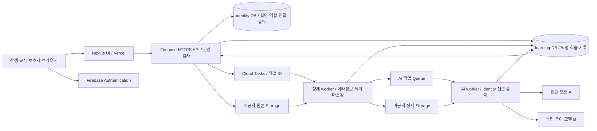
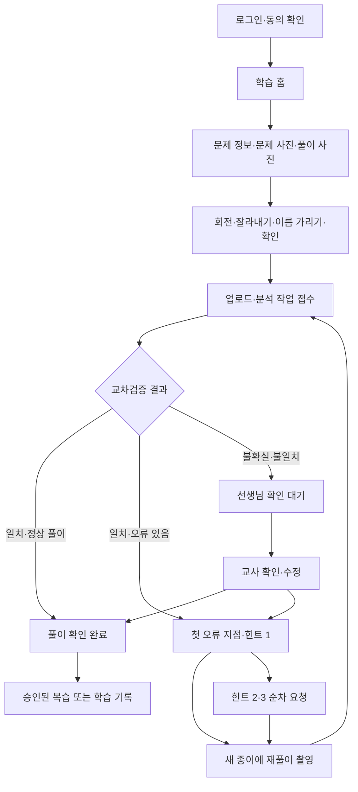

# 수학 손글씨 풀이 AI 진단 서비스 — 개발·UI/UX 상세서

| 항목 | 기준 |
|---|---|
| 문서 버전 / 작성일 | 1.0 / 2026-10-06, Asia/Seoul |
| 대상 | 학원 내부 운영, 학생 15명 파일럿, 대표 1명·교사 4명 |
| 문서 용도 | 화면 설계, 프론트엔드·백엔드 구현, DB·AI 설계, 인수 검수의 공통 기준 |
| 상태 | 구현 기준 권장안. 발주사의 계약·운영 승인을 이미 받았다는 의미는 아님 |
| 근거 | 사용자 제공 프로젝트 개요·필수 범위. 현재 작업 폴더에 기존 MVP 코드·답안 9건·브랜드 파일·테스트가 없음을 확인 |
| 수치의 의미 | 별도 출처가 없는 수치는 이 문서가 제안하는 제품 규칙·초기 설정·검수 목표이며 측정된 성능이 아님 |

## 목차

1. [범위·목표·미정 사항의 결정](#s01)
2. [사용자·권한·정보 구조](#s02)
3. [서비스 구조·사용자 흐름](#s03)
4. [도메인 상태·집계 규칙](#s04)
5. [디자인 토큰·레이아웃·반응형](#s05)
6. [공통 컴포넌트 규격](#s06)
7. [공통 화면·로그인](#s07)
8. [학생용 화면](#s08)
9. [교사용 화면](#s09)
10. [학부모용 화면](#s10)
11. [AI 분석·교차검증·힌트](#s11)
12. [복습 생성·교사 수정 활용](#s12)
13. [DB·파일·인덱스 설계](#s13)
14. [API 계약·비동기 작업](#s14)
15. [검증·오류·로딩·예외](#s15)
16. [접근성·콘텐츠·보안](#s16)
17. [개인정보·동의·보관·삭제](#s17)
18. [검수 시나리오·파일럿 평가](#s18)
19. [구현 순서·인수·운영](#s19)
20. [설계 결정·공식 참고 자료](#s20)

<a id="s01"></a>
## 1. 범위·목표·미정 사항의 결정

### 1.1 서비스 원칙

- 숙제는 교사가 시중 교재로 내고 학생이 집에서 푼다. 시스템은 학생이 제출한 개별 문제를 분석한다.
- 한 제출 건은 **교재의 문제 1개 와 그 문제에 대한 학생 풀이**다. 한 사진의 여러 문제를 자동 분리하는 기능은 이번 범위에 없다.
- 최초 풀이와 재풀이를 구분해 기록한다. 틀린 풀이에 대한 힌트는 3단계이며 최종 답, 완성 풀이, 마지막 계산 결과를 학생·학부모에게 제공하지 않는다.
- 분석의 일치 여부는 정오 판단뿐 아니라 문제 해석·풀이의 최초 오류 지점까지 검사한다. 불일치·읽기 어려움·판정 불가 시 교사 확인으로 전환한다.
- 정답을 맞혔더라도 풀이에 오류가 있으면 정답 판정 대신 `INCORRECT`로 기록하고 학생 문구는 “답에 이르기 전 풀이를 다시 살펴봐요”로 표시한다.
- 교사의 판단이 학생 공개 결과의 최종 기준이다. AI 원본과 교사 수정 기록은 별도로 보존한다.
- 리포트는 요청한 보호자에게만 교사가 확인한 스냅샷을 공개한다. 자동 이메일·문자 발송은 구현하지 않는다.

### 1.2 포함·제외

| 포함 | 제외 |
|---|---|
| 학생 촬영·업로드·진단·힌트·재풀이·복습 | 출결·수납·상담 일정·결제 |
| 담당 학생의 교사 대시보드·검수·이력 | 숙제 배정 시스템, 마감·미제출 관리, 교재 문제 자동 수집 |
| 계정·담당 교사·보호자 연결·동의·삭제 | 공개 회원가입, 학원 간 멀티 테넌트, 외부 판매 |
| 학년·단원·개념 기준 데이터와 소규모 생성 템플릿 | 상용 교재를 복제하는 문제은행·검색 엔진 |
| DB 신규 구축, MVP 점검 절차, 운영 문서 | 앱스토어 앱, 오프라인 AI 분석, 챗봇 자유 대화 |
| 리포트 웹 열람 및 브라우저 인쇄/PDF 저장 | 자동 PDF 메일 발송·실시간 보호자 모니터링 |

**숙제 미제출 인원은 계산하지 않는다.** 전체 숙제 목록이 시스템에 없으므로 업로드한 문제 수를 숙제 이행률로 표시하지 않는다. 촬영 수·문제 수·시도 수를 각각 구분한다.

### 1.3 구현 기본 결정

| 미정 항목 | 이번 구현 기준 | 대안·영향 |
|---|---|---|
| 복습 생성 | 학년·단원·개념·난도 구조화 + 교사 작성 템플릿 10개 + AI 변형 + 독립 검증 + 교사 승인 | 키워드 생성만: 초기 작업 감소, 편차·검수 부담 증가. 대형 DB/RAG: 입력·권리 검토·관리 UI 추가, 이번 범위 제외 |
| 스택 | GitHub + Next.js/TypeScript + Vercel + Firebase Auth/Firestore/Storage + Firebase 2세대 Functions/Cloud Tasks 유지 | 별도 SQL 서버 전환은 현재 운영 경험·권한 구현·이관 부담 증가. 파일럿 이후 필요성이 확인될 때 재검토 |
| 교사 수정 반영 | 수정 이력 + 대표가 승인한 익명 예시·규칙 + 정확한 개념 필터 검색. 자동 학습·파인튜닝 제외 | 이력만 저장: 구현 감소, 재사용 효과 없음. 자동 반영: 잘못된 수정 확산 위험·평가 기능 증가 |
| 지원 교육 범위 | 계정 등록은 초 1~고 3 전체. 자동 힌트·복습은 검증된 단원만 허용 | 지원 미검증 단원의 제출은 저장·교사 검수 가능하며 AI 힌트 자동 공개 불가 |
| 최초 지원 단원 | 중 1 일차방정식의 정수·유리수 계수, 분배법칙·이항·등식 성질, 도형/그래프 없는 유형 | 다른 학년 파일럿은 해당 단원 평가 세트가 합격한 후 `AUTO_ENABLED`로 승격 |
| 보호자 리포트 | 날짜 범위의 제출 기록 기반, 교사 확정 후 웹 공개 | 자동 실시간 공개보다 공개 판단·문구 확인이 필요하지만 미검수 결과 노출을 방지 |

15명 의 실제 학년·단원 정보는 제공되지 않았다. 따라서 검증 범위를 임의로 전 학년에 확대하지 않는다. 화면과 데이터는 초·중·고 모두 구현하고, 대표가 파일럿 학생의 단원별 검증 상태를 설정한다. 자동 처리 미지원 단원도 교사가 판정·지도 기록을 작성할 수 있다. 교사 작성 힌트는 11.5의 A/B 일치와 수학 검수·안전 확인 조건을 만족한 경우에만 공개한다. 불일치가 남으면 대면 지도·기록으로 처리한다.

### 1.4 비용·기간 비교의 산정 방법

실제 총예산·납기·업체 단가가 없으므로 아래는 계약 견적이 아닌 **추가 작업량 추정**이다. 1인일은 8시간이며 기획·개발·검증 시간을 포함한다. UI 전체·기본 AI 진단·계정·DB 구축 공통 비용은 제외한 기능 간 차이만 비교한다.

| 선택 | 공통 기반 대비 추가 인일 | 비용 차이 예시: 1인일 40만 원 가정 | 일정 영향·운영 부담 |
|---|---:|---:|---|
| 키워드 구조화 생성 + 교사 승인 | 3~5 | 120~200만 원 | 초기 빠름, 매 생성 검수 필요 |
| 권장: 템플릿 10개 + 키워드 + 검증 + 승인 | 6~9 | 240~360만 원 | 위 대안 대비 +3~4인일, 교사 템플릿 검토 별도 |
| 참고 문제 DB 100개 + 검색 + 등록 관리 | 13~20 | 520~800만 원 | 권장안 대비 +7~11인일, 콘텐츠 작성·권리 확인 별도 |
| Firebase 유지 | 0(기준) | 0 | 현재 운영 경험을 활용 |
| SQL/Auth/Storage 구성으로 전환 | +5~9 | +200~360만 원 | 기존 MVP 이관은 자료 확인 후 별도 산정 |
| 교사 수정 이력만 | 1~2 | 40~80만 원 | 이후 진단의 근거로 검색하지 않음 |
| 권장: 이력 + 승인 규칙/예시 재사용 | 4~6 | 160~240만 원 | 이력만 대비 +3~4인일 |
| 파인튜닝·자동 회귀평가까지 | +10~20 이상 | +400~800만 원 이상 | 데이터 부족, 이번 파일럿에는 권장하지 않음 |

단가는 설명용 가정이며 VAT·유료 클라우드·AI 호출·컨텐츠 검수 인건비·유지보수는 제외한다. 기능별 인일을 중복 합산하지 않는다. 권장안 전체는 8주 계획(19장)으로 시작하되 실제 MVP 점검 후 재산정한다.

<a id="s02"></a>
## 2. 사용자·권한·정보 구조

### 2.1 역할 및 접근 판정

`role = STUDENT | TEACHER | PARENT | ADMIN`. 대표는 `ADMIN`이며 교사 기능과 전체 학생 접근을 갖는다. 일반 교사는 담당 학생만 접근한다. 역할 선택 UI 로 권한을 바꾸지 않는다. 서버의 계정·연결 테이블을 권한의 원본으로 삼고 Firebase custom claims 는 보조로 사용한다.

| 기능 | 학생 | 담당 교사 | 연결 보호자 | 대표 |
|---|---|---|---|---|
| 학생 실명·계정 정보 | 자기 최소정보 | 담당 학생 | 연결 자녀 이름·학년 | 전체 |
| 풀이 제출·재풀이·힌트 열람 | 자기만 | 학생 대신 제출 불가 | 불가 | 학생 대신 제출 불가 |
| 학습 기록 | 자기 공개 결과 | 담당 전체 | 공개된 리포트만 | 전체 |
| 원본 이미지·독립 풀이·정답 | 자기 제출 이미지만 | 담당 전체 | 불가 | 전체 |
| 진단 수정·복습 승인·리포트 발행 | 불가 | 담당만 | 불가 | 전체 |
| 담당 관계·역할·동의·삭제 | 불가 | 조회·요청만 | 동의 확인·삭제 요청 | 설정·실행 |
| AI 규칙 승인·버전 배포·중지 | 불가 | 규칙 후보 제출 | 불가 | 가능 |

담당 관계는 `teacherUid ↔ learnerId`, 보호자 관계는 `parentUid ↔ learnerId`이며 `ACTIVE` 상태와 유효 기간을 모두 만족해야 한다. 주소의 `learnerId`·`caseId`·`reportId`를 바꿔도 다른 학생 데이터에 접근할 수 없어야 한다. 권한 없는 개별 자원 조회는 존재 여부를 숨기기 위해 404를 반환한다. 역할 자체가 잘못된 메뉴 접근은 403을 반환한다.

### 2.2 인증·계정

- 공개 가입 없음. 대표가 계정 등록, 담당 교사 지정, 보호자 연결을 수행한다.
- 학생은 `로그인 아이디 + 비밀번호`, 교사·보호자·대표는 `이메일 + 비밀번호`를 사용한다. 학생 ID 는 `s` + 난수 영숫자 8자(예: `s7p4k2m8a`), 내부 관리번호·실명에서 유도하지 않는다.
- 학생 ID 는 서버가 로그인용 내부 이메일 별칭으로 매핑하여 Firebase 이메일/비밀번호 Auth 를 사용한다. 내부 이메일은 학생 응답·로그에 반환하지 않는다. 공개 가입을 차단하고 생성된 UID 가 활성 계정 테이블에 있을 때만 API 사용 가능하다.
- 임시 비밀번호는 난수 12자, 첫 로그인 비밀번호 변경 필수. 저장·재조회 불가. 대표가 생성 직후 한 번 표시하고 별도 전달한다. 로그인 아이디 변경은 이번 범위 제외.
- 비밀번호는 12~64자, 모든 역할 동일. 공백·붙여넣기·비밀번호 관리자 사용 허용. 알려진 유출 비밀번호 차단을 인증 제공자 설정과 서버 정책에 맞춰 구현한다. 직접 암호 해시를 별도 DB 에 저장하지 않는다.
- 학생 로그인은 중앙 로그인 API 로 Firebase Auth REST 호출 후 인증 토큰을 반환하고 웹 Auth 세션을 구성한다. 교사·보호자는 Firebase SDK 로그인. 토큰은 Authorization Bearer 로 전송하며 URL·분석 이벤트에 기록하지 않는다.
- 학생은 기본 세션 저장(탭 종료 시 삭제), “이 기기에서 로그인 유지” 선택 시 로컬 유지. 교사·대표는 세션 저장만, 보호자는 기본 세션 저장. `로그아웃` 시 Firebase 세션과 앱 캐시를 모두 지운다.
- 분실한 학생 비밀번호는 교사가 대표에게 재설정 요청, 대표가 임시 비밀번호 발급. 교사·보호자는 인증 제공자 비밀번호 재설정 이메일을 명시적으로 요청할 수 있다. 본 프로젝트 문서 작성 중 이메일을 발송하지 않는다.
- 계정 `INVITED | ACTIVE | SUSPENDED | DELETION_PENDING | DELETED`. `mustChangePassword`를 별도로 기록한다. `INVITED`는 로그인·/me·비밀번호 변경·동의 상태 조회만 가능하며 학습 API 는 차단한다. 비밀번호 변경과 CORE_LEARNING 동의 확인이 완료되면 ACTIVE, EXTERNAL_AI 동의는 분석 호출의 별도 조건이다. 중지·삭제 대기 계정은 모든 학습 API 차단.

<a id="s03"></a>
## 3. 서비스 구조·사용자 흐름

### 3.1 권장 시스템 구조



- GitHub 는 소스·PR·배포 이력, Vercel 은 UI 제공, Firebase 는 계정·DB·파일·API·worker 를 담당한다.
- `/api/v1/**`는 같은 도메인의 프록시로 Firebase HTTPS API 에 연결한다. 민감 데이터의 SSR/ISR·공유 캐시를 사용하지 않는다.
- DB 브라우저 직접 읽기·쓰기는 모두 차단한다. 이미지 업로드만 서버 발급 업로드 세션에 허용하며 파일을 분석하는 API 는 별도 호출한다.
- 정제 worker 와 권한을 검사하는 이미지 API 만 원본 Storage 를 읽는다. AI worker 는 정제 파일과 learning DB 만 접근하며 identity DB·원본 버킷에 IAM 권한이 없다.
- DB 는 동일 Firebase 프로젝트의 `identity`와 `learning` named DB 로 분리하고 DB 별 IAM 조건을 설정한다. 실제 권한 차단을 통합 테스트한다. 서비스 계정 분리가 불가능한 배포 환경이라면 identity 를 별도 프로젝트에 두어 같은 조건을 만족시킨 후 운영한다.
- Functions/DB/Storage 는 가능한 한국 리전을 우선한다. 외부 AI·Vercel 까지 국내 처리라고 주장하지 않는다.
- Cloud Tasks의 재시도·동시 실행 제한을 이용한다. 장시간 AI 작업을 UI HTTP 응답 안에서 완료하려 하지 않는다. [Firebase task queue 공식 문서](https://firebase.google.com/docs/functions/task-functions)

### 3.2 학생 흐름



정답인 최초 제출에는 복습을 자동 생성하지 않는다. 한 번이라도 틀린 원문 문제에는 복습 후보 1개 를 생성하며, 교사 승인 뒤 원문이 `RESOLVED` 또는 `TEACHER_CLOSED`일 때 학생에게 제공한다. 복습 문제의 오답에서 추가 복습을 재귀 생성하지 않는다.

### 3.3 교사·보호자 흐름

교사: 로그인 → 수업 준비 대시보드 → 담당 학생/확인 대기 건 → 이미지·인식문·진단·독립풀이 비교 → 확인/수정 → 학생 공개 결과 갱신 → 반복 개념·재풀이 상태 점검 → 복습 후보 승인 → 요청 리포트 확인·발행.

보호자: 대표가 계정 연결 → 로그인 → 연결 자녀 선택 → 리포트 요청(최근 7/30일 또는 날짜 범위) → 교사 발행 대기 → 발행 리포트 열람·인쇄. 다른 자녀·다른 보호자의 링크는 접근 불가. 요청 없이 자동 발행하지 않는다.

### 3.4 경로·이동 계약

| 화면 ID | URL | 이동·이탈 규칙 |
|---|---|---|
| A-01 로그인 | `/login` | 성공 시 역할 기본 홈. `returnTo`는 동일 도메인·권한 있는 경로만 허용 |
| A-02 최초 설정 | `/onboarding` | 비밀번호·동의 확인 후 홈. 미완료 상태는 다른 학습 경로 차단 |
| A-03 계정 | `/account` | 비밀번호 변경·로그아웃·연결정보·삭제 요청 |
| S-01 학생 홈 | `/student` | 제출 시작·진행 건·최근 기록 |
| S-02 최초 제출 | `/student/submissions/new` | 문제·풀이 입력, 제출 전 이탈 확인 |
| S-03 사진 편집 | 위 화면의 전면 dialog | 닫기 시 변경 유지 여부 명시, 뒤로가기는 dialog 만 닫기 |
| S-04 진행·결과 | `/student/cases/:caseId` | 서버 상태에 따라 진행/대기/정오·힌트 화면 전환 |
| S-05 재풀이 | `/student/cases/:caseId/retry` | 원문 문제 재사용, 새 풀이만 입력 |
| S-06 기록 | `/student/history` | 상태·날짜 필터, 상세로 이동 |
| S-07 복습 | `/student/reviews/:reviewId` | 승인·원문 완료 조건 검사 후 시작·제출·결과 |
| T-01 수업 준비 | `/teacher` | ADMIN 도 동일 화면, 전체/담당 범위 표시 |
| T-02 학생 목록 | `/teacher/students` | 검색·학년·담당 필터·학생 상세 |
| T-03 학생 상세 | `/teacher/students/:learnerId` | 문제 이력·개념·기본 학습 설정 |
| T-04 검수 목록 | `/teacher/reviews` | 진단 확인/설명 필요/복습 후보 탭 |
| T-05 진단 검수 | `/teacher/cases/:caseId` | 읽기/수정 모드, 미저장 이탈 확인 |
| T-06 복습 검수 | `/teacher/review-items/:reviewId` | 후보 확인·반려·수정·승인 |
| T-07 리포트 관리 | `/teacher/reports` | 요청 목록·발행/회수 이력 |
| T-08 리포트 편집 | `/teacher/reports/:reportId` | 지표·교사 코멘트·미리보기·발행 |
| T-09 운영 설정 | `/admin/settings` | 계정·관계·동의·보관·AI 규칙/버전. ADMIN 전용 |
| P-01 리포트 홈 | `/parent` | 자녀·요청 상태·공개 리포트 목록 |
| P-02 리포트 상세 | `/parent/reports/:reportId` | 발행된 스냅샷만, 인쇄 |
| E-01 공통 예외 | 기존 URL 에서 표시 | 403/404/503, 역할 홈·재시도 CTA |

목록의 필터·정렬·cursor 는 URL query 로 저장한다. 상세에서 돌아오면 이전 필터와 스크롤 위치를 복원한다. 새로운 경로 진입은 H1에 focus, 브라우저 뒤로가기는 기존 위치 복원. 수정 폼 이탈은 `저장하지 않고 나가기 / 계속 작성` dialog, 이미 서버에 접수된 분석 건은 이탈 확인 불필요. 학생 이미지 초안은 메모리만 유지하므로 새로 고침 후 복구 불가임을 제출 전 안내한다.

<a id="s04"></a>
## 4. 도메인 상태·집계 규칙

### 4.1 상태를 분리한다

`jobStatus`는 처리, `verdict`는 평가, `caseStatus`는 학생의 해결 진행, `reviewStatus`는 교사 업무다. 문자열 하나로 네 의미를 혼합하지 않는다. 시간은 DB UTC Timestamp, 표시는 Asia/Seoul `YYYY.MM.DD HH:mm`. 날짜 필터는 한국 시간의 시작일 00:00 이상, 종료일 다음날 00:00 미만이다.

| 상태 종류 | enum | 학생 표시 / 의미 |
|---|---|---|
| 작업 | `QUEUED` | “분석을 기다리고 있어요” |
| 작업 | `SANITIZING` | “사진을 준비하고 있어요” |
| 작업 | `ANALYZING` | “풀이를 읽고 확인하고 있어요” |
| 작업 | `VERIFYING` | “한 번 더 확인하고 있어요” |
| 작업 | `SUCCEEDED` | 판정/대기 결과로 전환 |
| 작업 | `FAILED` | “분석을 끝내지 못했어요”, 오류 코드에 맞는 복구 |
| 판정 | `CORRECT` | “풀이가 맞아요” |
| 판정 | `INCORRECT` | “이 부분을 다시 살펴봐요” |
| 판정 | `UNREADABLE` | “글씨를 더 잘 보이게 찍어 주세요” |
| 판정 | `UNDETERMINED` | “선생님이 확인하고 있어요” |
| 문제 진행 | `PROCESSING` | 현재 시도의 분석 중 |
| 문제 진행 | `RETRY_REQUIRED` | 공개 가능한 오답, 재풀이 가능 |
| 문제 진행 | `WAITING_TEACHER` | 공개 보류/한도 초과/설명 요청 |
| 문제 진행 | `RESOLVED` | 최초 또는 재풀이 `CORRECT`, 활동 완료 |
| 문제 진행 | `TEACHER_CLOSED` | 교사 직접 지도 완료. 정답 판정과 구분 |
| 검수 | `NONE` | 자동 통과, 추가 검수 없음 |
| 검수 | `PENDING` | 교사 확인 필요 |
| 검수 | `IN_REVIEW` | 교사 열람·검수 진행 표시, 잠금은 아님 |
| 검수 | `CONFIRMED` / `CORRECTED` | 교사 확정 / 변경 확정 |

복습은 `GENERATING → PENDING_APPROVAL → APPROVED → AVAILABLE → IN_PROGRESS → COMPLETED`. 실패는 `GENERATION_FAILED`, 반려는 `REJECTED`. APPROVED 는 교사 승인됐으나 원문 미완료로 아직 학생에게 표시되지 않는 상태다. 리포트는 `REQUESTED → DRAFT → PUBLISHED → WITHDRAWN`; 수정 후 재발행은 새 버전 생성이다.

### 4.2 전이·한도

1. 최초 제출 생성 성공 시 `attemptIndex=1`, `caseStatus=PROCESSING`. 분석 단계에서 읽기 어려운 사진은 판정 `UNREADABLE`, 진행 `WAITING_TEACHER`, 검수 `PENDING`; 재촬영 버튼을 추가로 제공한다.
2. 자동 검증 통과 + `CORRECT` → `RESOLVED`. 자동 검증 통과 + `INCORRECT` → `RETRY_REQUIRED`. 나머지 → `WAITING_TEACHER`; 모든 힌트 공개를 중지한다.
3. `RETRY_REQUIRED`에서 재풀이 제출 시 기존 완료된 시도를 변경하지 않고 새 attempt 를 생성한다. 동시에 처리 중인 시도는 원문당 1개 만 허용한다.
4. 정상 평가 시도는 최초 1회 + 재풀이 3회, 최대 4회. 네 번째 `INCORRECT`면 `WAITING_TEACHER`, “여기까지 잘 시도했어요. 선생님과 함께 확인해요”. 이미 공개한 안전한 힌트는 계속 열람 가능하되 신규 힌트·재풀이 버튼은 중지한다.
5. CORRECT/INCORRECT 로 확정된 시도만 평가 횟수에 1회 포함한다. FAILED·UNREADABLE·UNDETERMINED·풀이 부족·AI 불일치·지원 미검증·개인정보 보류는 포함하지 않는다. 교사가 처음으로 CORRECT/INCORRECT 를 확정하면 그때 1회 계상하며 이후 수정은 중복 계상하지 않는다. 기술 재시도는 같은 attemptId/jobId, 재촬영·풀이 추가는 같은 attempt 의 새 inputRevision 으로 처리하고 이전 입력은 보존한다.
6. 학생 “선생님께 질문”은 서버에 `helpRequested=true`, `caseStatus=WAITING_TEACHER`, `reviewStatus=PENDING` 설정. 자유 질문은 300자, 정답 요청에도 자동 답을 반환하지 않는다. 교사 확인 전 재풀이 제출은 불가.
7. 교사 CORRECT 확정은 RESOLVED. INCORRECT 확정은 남은 정상 평가 횟수>0이고 11.5의 공개·재풀이 조건이 충족될 때만 RETRY_REQUIRED, 그 외 WAITING_TEACHER 다. TEACHER_CLOSED 는 설명 내용 20~1000자 와 완료 사유 필수이며 정답 확정과 구분한다.
8. 한도 도달 후 담당 교사가 “추가 재풀이 1회 허용”을 누르면 이유 10~300자 와 감사 이력을 저장하고 `extraAttemptAllowance+=1`. 최대 2회 까지. 무한 시도 허용 없음.
9. `RESOLVED`가 교사 수정으로 오답이 되면 공개 결과의 버전을 올리고 학생 홈에 “선생님이 풀이를 다시 확인했어요”를 표시한다. 복습 진행 중이면 신규 제출 잠시 차단, 복습은 기록 보존 후 `APPROVED`로 되돌린다. 이미 완료된 복습을 삭제하지 않는다.

### 4.3 집계의 정확한 정의

| 지표 | 계산·제외 조건 |
|---|---|
| 제출 문제 수 | 선택 기간에 최초 접수된 ORIGINAL case 수. 사진·재풀이·복습 수 제외 |
| 최초 정답률 | 최초 시도의 현재 유효 판정 `CORRECT / (CORRECT + INCORRECT)` × 100. 미확정·읽기 불가 제외, 분모 0은 `—` |
| 오답 문제 수 | 유효 시도 중 `INCORRECT`가 1회 이상 있는 ORIGINAL case 수. 문제당 1건 |
| 재풀이 완료 | 오답이 있었고 재시도의 현재 유효 판정이 `CORRECT`인 ORIGINAL case 수 |
| 재풀이 완료율 | 재풀이 완료 / 오답 문제 수 × 100. 교사 지도 완료는 별도 건수, 분자에서 제외 |
| 교사 확인 대기 | 최신 시도 검수 PENDING/IN_REVIEW 또는 helpRequested=true 이며 미해결인 case 수 |
| 반복 오답 개념 | 최근 14일 서로 다른 ORIGINAL case 에서 같은 확정 conceptId 오답이 3건 이상 |
| 취약 개념 표시 | 최근 30일 해당 개념 판정 가능 문제 3건 이상이고 최초 오답률 50% 이상. `가능성` 문구, 능력 진단으로 확정 표현 금지 |
| 설명 필요 | 도움 요청, 정상 평가 4회 실패, 같은 개념 반복 오답, 교사 직접 체크 중 하나. 사유 배열 저장 |
| 힌트 사용 | 문제별 실제 반환·노출된 최대 단계 0~3, 버튼 클릭 횟수로 계산하지 않음 |

비율은 소수점 첫째 자리 반올림, 교사 화면에는 분모/분자 병기(예: `66.7% · 2/3`). 리포트의 문제 묶음은 기간 내 최초 제출된 case 를 기준으로 생성 시점까지의 시도를 포함한다. 기간 이후 재풀이를 포함한 경우 “재풀이 상태는 작성일 기준” 표시. 생성 후 데이터 변경은 기존 공개 스냅샷을 자동 변경하지 않는다.

<a id="s05"></a>
## 5. 디자인 토큰·레이아웃·반응형

### 5.1 시각 방향·색상

학생은 한 화면에 주 행동 1개, 교사는 상태를 비교할 수 있는 밀도, 보호자는 기간·변화·지도 의견을 우선한다. 장식용 그래디언트·마스코트·게임 보상·다크모드는 이번 범위에 없다. 상태는 색상과 아이콘·텍스트를 항상 함께 표시한다.

| CSS 토큰 | HEX | 사용 기준 |
|---|---|---|
| `--color-primary` | `#1D4ED8` | 주요 버튼, 선택 탭, 링크, focus |
| `--color-primary-hover` | `#1E40AF` | Primary Hover |
| `--color-primary-active` | `#1E3A8A` | Primary 눌림 |
| `--color-canvas` | `#F8FAFC` | 페이지 바탕 |
| `--color-surface` | `#FFFFFF` | 카드·폼·모달 |
| `--color-text` | `#0F172A` | 제목·본문 |
| `--color-secondary` | `#475569` | 설명·보조 정보 |
| `--color-muted` | `#64748B` | 날짜·placeholder. 흰색/Canvas 배경에서만 |
| `--color-divider` | `#E2E8F0` | 장식용 카드 경계·구분선 |
| `--color-control-border` | `#64748B` | 입력·드롭다운·체크박스 식별 경계 |
| `--color-success` / `--color-success-bg` | `#15803D` / `#F0FDF4` | 맞는 풀이·완료 |
| `--color-warning` / `--color-warning-bg` | `#92400E` / `#FFFBEB` | 교사 확인·보류·주의 |
| `--color-error` / `--color-error-bg` | `#B91C1C` / `#FEF2F2` | 입력 실패·확정 오류 위치·통신 오류 |
| `--color-info-bg` | `#EFF6FF` | 힌트·안내; 글자는 Primary/Text |
| `--color-disabled-bg` | `#E2E8F0` | 비활성 배경; 글자는 Secondary |
| `--color-overlay` | `rgba(15,23,42,0.48)` | dialog 뒤 화면 가림 |

계산 기준 대비: Primary/White 6.70:1, Muted/Canvas 4.55:1, Success/Success-bg 4.79:1, Warning/Warning-bg 6.84:1, Error/Error-bg 5.91:1. 추가 색 조합은 일반 글자 4.5:1, 큰 글자·UI 식별 3:1 이상을 다시 검사한다. Divider 는 컨트롤의 유일한 경계로 사용하지 않는다. 잘못된 풀이 표시를 페이지 전체 빨간색으로 구성하지 않는다.

### 5.2 타이포그래피·아이콘·수식

기본 폰트 `Pretendard, system-ui, -apple-system, "Segoe UI", sans-serif`. WOFF2 400/600/700을 자체 호스팅하고 `font-display: swap`. 글자 간격 기본 0, 한글 제목만 -0.02em. 숫자·표는 `tabular-nums`. 폰트 파일 라이선스를 소스에 포함한다.

| 용도 / 토큰 | 학생·보호자 | 교사 Desktop | 굵기 |
|---|---|---|---:|
| H1 / `title-lg` | 24px / 32px | 28px / 40px | 700 |
| H2 / `title-md` | 20px / 28px | 동일 | 700 |
| H3 / `title-sm` | 18px / 26px | 동일 | 600 |
| 본문·힌트 / `body` | 16px / 26px | 동일 | 400 |
| 입력·버튼 / `control` | 16px / 24px | 동일 | 400 / 600 |
| label·보조·표 / `body-sm` | 14px / 22px | 동일 | 400, label 600 |
| 배지·메타 / `caption` | 12px / 18px | 동일 | 600 |
| 주요 통계 / `metric` | 28px / 36px | 32px / 40px | 700 |

12px 는 짧은 상태·날짜에만 사용하고 안내·힌트·오류 문구는 14px 이상. 학생 오류·힌트 설명은 16px. 본문 `word-break: keep-all; overflow-wrap: anywhere`. 긴 교재명은 목록에서 최대 2줄, 상세는 전체 표시. 생략된 제목은 focus/hover tooltip 및 상세에서 확인한다.

아이콘은 동일 SVG 세트, 기본 20px·stroke 2px, 큰 안내 48px. 아이콘 단독 조작은 48×48px 영역과 `aria-label`. 정보 의미 없는 아이콘은 `aria-hidden=true`.

수식은 KaTeX 와 MathML 접근성 출력, `trust:false`, HTML 삽입 금지, 허용 LaTeX 명령 화이트리스트 적용. 수식은 본문 18px, block 20px. 긴 수식만 해당 block 에서 가로 스크롤·키보드 focus 가능하게 하고 전체 페이지 overflow 는 금지. 문제 이미지에 대한 인식문은 `확인된 인식문/인식 확인 필요`를 구분한다. 수식 렌더 실패는 평문 수식과 “수식 표시를 다시 불러와 주세요”를 제공하며 답을 임의 수정하지 않는다.

### 5.3 간격·크기·표면

- spacing 토큰: `4, 8, 12, 16, 20, 24, 32, 40, 48, 64px`. 같은 깊이의 카드 간격 16px, 큰 section 간격 24px Mobile/32px Desktop.
- Radius: 입력·버튼 8px, 카드·이미지 12px, dialog 16px, 배지 999px.
- 경계 기본 1px. 카드 shadow 없음. dialog `0 12px 32px rgba(15,23,42,.16)`, dropdown `0 8px 24px rgba(15,23,42,.12)`.
- z-index: 일반 0, sticky header 20, bottom CTA/nav 30, dropdown/tooltip 40, modal overlay 80, modal 90, toast 100.
- 모션: 배경·색 120ms, 열기·닫기 160ms ease-out, spinner 800ms linear. `prefers-reduced-motion: reduce`에서 이동·shimmer 제거, 진행 문구 유지.
- 크기는 CSS px, 너비는 border-box. 아래 명시 높이는 **최소 높이**이며 텍스트 확대 시 늘어난다.

### 5.4 Grid·Breakpoint

| viewport CSS 너비 | Grid·padding | 학생·보호자 | 교사 |
|---|---|---|---|
| 320~359 | 4열, gap12, 좌우 12 | 1열, CTA100%, header56 | drawer 메뉴, 표→카드, 검수 세로 |
| 360~767 | 4열, gap16, 좌우 16 | 표준 390, 1열 | 같은 카드형 보조 사용 |
| 768~1023 | 8열, gap24, 좌우 24 | 본문 max480 중앙, 리포트 max720 | drawer 메뉴, 통계 2열, 검수 세로 |
| 1024~1279 | 8열, gap24, 좌우 24 | 학생 max480, 리포트 720 | sidebar72, 표 유지, 검수 세로/탭 |
| 1280~1439 | 12열, gap24, 좌우 32 | 동일 | sidebar224, 통계 4열, 검수 6:6 |
| 1440 이상 | 12열, gap24, 좌우 32 | 동일 | 기준 1440, 본문 max1440 중앙 |

교사 본문 실너비 = `min(1440px, viewport - sidebar - 2×padding)`. 1440 기준 본문은 1152px(1440−224−64). 검수 6:6은 각각 564px(1152−24)/2. 1920 이상에도 표·form 이 무제한 늘어나지 않는다. 지원 최소 너비 320px, 세로/가로 방향 모두 가능하다.

학생 header sticky top0 높이 56+상단 safe-area, 교사 header64. 학생 하단 nav 는 64+하단 safe-area, 아이템 3개 동일 너비. CTA bar 는 버튼 48 + padding 상 12/하 12 + safe-area, 흰 배경·상단 1px Divider. 촬영/재풀이/복습 제출 폼은 nav 를 숨기고 CTA bar 만 사용한다. 상세 힌트 화면은 nav 와 별도 고정 CTA 를 동시에 두지 않는다. 본문 하단 padding 은 활성 하단 bar 실제 높이+24px.

가상 키보드 표시 시 CTA 는 viewport 를 가리지 않도록 일반 흐름으로 전환하고 활성 필드가 visible viewport 중앙에 오도록 scroll 한다. `100dvh`를 사용하며 주소창 높이를 고정값으로 추정하지 않는다. 파일 선택 이후 화면 위치는 미리보기 시작점으로 이동하되 사용자 입력을 지우지 않는다.

### 5.5 화면별 반응형 우선순위

학생 사진·결과·재풀이: 모든 너비에서 1열, 이미지→설명→행동 순서 유지. 보호자 리포트: 768 이상 요약카드 2열, 본문 1열. 교사 목록: 768 미만 모든 열을 label/value 카드로 변경, 768~1023 표는 필요한 열만 축약하고 상세 열람으로 연결. 1024 이상 표 7열 유지하며 표 영역만 가로 스크롤 가능. 교사 검수: 1280 이상 원본·인식/검수 form2열, 이하 원본→비교→form, 저장 bar 는 form 하단 sticky. 필터는 1280 이상 한 줄, 768~1279 두 줄, 이하 “필터” dialog 에 입력을 배치하고 적용 상태 칩을 본문에 표시한다.

<a id="s06"></a>
## 6. 공통 컴포넌트 규격

### 6.1 상태 정의와 우선순위

상태 합성 우선순위: `Loading > Disabled > Error > Active > Focus > Hover > Default`. Focus ring 은 Error/Active 와 함께 유지한다. 버튼에는 Empty 상태를 적용하지 않고, 목록에는 Active 를 조작 선택에만 적용한다. 적용되지 않는 상태를 빈 변형으로 만들지 않는다.

| 상태 | 시각·동작 |
|---|---|
| Default | surface·정상 border·명시 label |
| Hover | `(hover:hover) and (pointer:fine)`에만, Primary dark/secondary info-bg. tooltip 은 focus 에도 표시 |
| Focus | `:focus-visible` Primary2px outline +2px offset. sticky/footer 에 가려지지 않음 |
| Active | pointerdown 동안 active 색, 크기 축소·레이아웃 이동 없음 |
| Selected | 탭/옵션/행에 선택 label·체크/밑줄. focus 와 분리 |
| Disabled | 배경 Disabled-bg, 글자 Secondary, native disabled. 인접 helper 로 비활성 이유 |
| Loading | spinner20px·“저장 중…” 등 동사, 너비 유지, 중복 이벤트 차단, aria-busy |
| Error | error border1px + 아이콘·문구. color 만 사용하지 않음 |
| Empty | 정상 응답의 0건. 제목·설명·복구 CTA, 실패와 구분 |

### 6.2 버튼·카드·폼

| 컴포넌트 | 규격 | 동작·예외 |
|---|---|---|
| PrimaryButton | min-h48, px20, gap8, radius8, 16/24 weight600, 아이콘 20 | 화면 주 CTA1개. Mobile w100%. 필수값 없을 때 이유를 함께 표시 |
| SecondaryButton | 동일, White·Primary 글자·Control-border1 | 취소/다시 촬영. Hover info-bg, Active `#DBEAFE` |
| TextButton | h48, px12, Primary, underline on hover/focus | 링크 이동은 a, 상태 변경은 button |
| DangerButton | h48, error bg·White text | 삭제·회수 확정 dialog 에만 사용 |
| CompactButton | 교사 표에서 min-h40, px12, 14/22 | Mobile 에서는 48로 변경. 행과 간격 8 이상 |
| IconButton | 48×48, icon24 | 이름·tooltip 필수. 비활성 이유 tooltip 만으로 전달하지 않음 |
| Card | padding16 Mobile/24 Desktop, gap12, borderDivider1, radius12 | 정적인 container. 클릭 카드는 제목 링크 사용, 전체 button 안에 button 중첩 금지 |
| StatusCard | padding16, 좌측 24icon·gap12, title18/26, body16/26 | state 색 배경, 현재 상태 1개+보조 사유 |
| Input | min-h48, px12, borderControl1, radius8, value16/24 | label14/22·600, label gap8, helper/error gap8 |
| Textarea | min-h112, padding12, line26, resize-y | max-h320, 글자수 우하단 14/22. AI 힌트 편집은 3칸 각각 300자 |
| PasswordInput | input + 오른쪽 48 아이콘영역 | “비밀번호 보기/숨기기”, autocomplete current/new-password, 붙여넣기 허용 |
| Checkbox/Radio | 시각 20×20·외곽 Control-border, 클릭 label min48 | 체크 Primary·White 체크, label gap12, fieldset/legend |
| Select | input48, 우측 20chevron·12px 여백 | 항목 20개 미만 native select 권장. 미선택 option “선택해 주세요” |
| Combobox | input48, popup max-h240, option min48 px12 | 단원·개념 검색, 빈 상태 “일치하는 단원이 없어요”. API 실패 시 재시도, 기존 선택 보존 |
| DateRange | 날짜 input48 두 개+gap12 | 형식 YYYY-MM-DD, min/max 와 한국시간 규칙. Mobile 세로 배치 |
| FieldError | icon16 + gap8, 14/22, Error | 한 필드 첫 오류 1개. 지우지 못하는 서버 오류는 form alert 에도 표시 |

Combobox 는 Tab 진입, Up/Down 후보 이동, Enter 선택, Escape 닫기, Home/End 첫/마지막, focus 는 input 에 유지하고 `aria-activedescendant`. 검색은 한글 IME composition 종료 후 300ms debounce. 후보 검색 중 Loading, 결과 0건 Empty, 오류 Error 를 구분한다. 이전 옵션을 loading 중 클릭할 수 없게 한다.

### 6.3 탐색·데이터 컴포넌트

| 컴포넌트 | 크기·구성 | 상호작용 |
|---|---|---|
| Tabs | tab min-h48 px16, gap0, 하단 2px Primary | tablist/tab/tabpanel, 좌우키 이동, Enter/Space 적용, Home/End, roving tabindex |
| Badge | min-h24 px8, gap4, icon14, 12/18·600 | 상태텍스트. 클릭 안 함. 필요한 동작은 옆 버튼 |
| Table | th48, td min64, cell px16 py12, font14/22 | thead sticky header 아래, scope=col. 정렬 button aria-sort, 행선택과 상세 링크 구분 |
| Pagination | pageSize20, “이전/다음” min48, gap12 | cursor pagination, 마지막 다음 disabled. 총건수는 서버 집계값만 |
| Timeline | 좌측 16marker, 세로 line1, 내용 gap8, 항목 간 24 | timestamp→사건→결과. ascending, 최신으로 이동 버튼 별도 |
| Accordion/Hint | header min56, padding16, icon20, content pt0 pb16 | button aria-expanded/controls, 하나씩 열어도 공개 단계 이력 유지 |
| FilterChip | min-h40/모바일 48, px12, 제거버튼 48 | label·선택값·해제. 색 alone 으로 필터 적용 표시 금지 |
| ImageViewer | w100%, preview max-h320 Mobile/560 Desktop, contain | zoom50~200%·25%씩, 90도회전, reset. 교사 원본은수평 pan 영역만 scroll |
| ErrorOverlay | 기준 정제 이미지 bbox 에 error2px 경계+번호 | 번호와 동일 인식문 줄을 focus/선택. 위치 확신 없으면 bbox 표시 금지, 줄 설명만 |
| ProgressSteps | step icon24 + label14/22, item min48 | 서버 실제 stage. 완료체크·진행 spinner·대기중·보류아이콘 |
| MetricCard | min-h112, padding20, label14, 숫자 Metric, 근거 14 | 클릭 가능 시 link 명시. 분모 0은 0% 대신— |

### 6.4 Modal·Toast·피드백

- 일반 dialog: desktop max-w560, padding24, header title20/28, description16/26, footer gap12·mt24. Mobile 좌우 16, padding20, max-height `calc(100dvh - 32px)`, 내용만 세로 scroll, CTA 가 내용과 겹치지 않는다.
- 사진 편집 dialog: mobile full-screen100dvh, 교사 desktop max-w960. 상단 취소/완료, 하단 도구. crop drag 외 수치/방향 버튼 대안(8장).
- 열기 시 제목 또는 첫 필수 필드 focus. background inert, focus trap, 닫을 때 trigger focus 복귀. Escape 는 변경이 없으면 닫고 변경이 있으면 discard 확인. 저장 중 dialog 는 닫기 차단 대신 닫아도 작업 상태를 유지하며 결과를 화면에서 확인 가능하게 한다.
- 삭제·발행·회수 확인은 구체적인 대상·영향을 표시한다. 삭제 dialog 는 `learnerId`/내부관리번호 입력 확인과 “삭제 요청 접수”를 사용하고 실제 삭제는 지연 작업(17장). 다른 일반 modal 은 배경 클릭으로 닫되 미저장 이탈 규칙 적용.
- Toast: max-w400, px16 py12, icon20·gap12·닫기 48, radius12. desktop top88 right24, mobile top(header+8) 좌우 16. 성공 4초, 정보 6초, hover/focus 동안 타이머 일시정지. 최대 2개, 같은 작업은 중복 합치기. `role=status`, 오류는 assertive1회 만.
- 행동이 필요한 오류·권한·삭제·보류는 Toast 로만 표현하지 않는다. 페이지/폼 alert 에 지속 표시한다.
- Skeleton: 300ms 이후 표시, 실제 카드·표·사진 비율과 동일한 공간 확보. 배경 Divider, shimmer1.5초, reduced motion 정지. 스켈레톤을 화면낭독기에서 숨기고 container aria-busy 사용.
- Empty: padding 상하 40, icon48, title18/26, description16/26, gap12, CTA1개. “학습 기록이 없어요 / 첫 풀이를 촬영해 보세요 / 풀이 촬영”과 “검색 결과가 없어요 / 필터를 바꿔 보세요 / 필터 초기화”를 구분한다.
- ErrorState: icon48·title18·설명 16·requestId14·재시도/홈 CTA. 사용자에게 provider response·stack trace·토큰·학생 개인정보를 표시하지 않는다.

<a id="s07"></a>
## 7. 공통 화면·로그인

### 7.1 A-01 로그인

목적: 발급된 계정으로 들어가 서버가 지정한 역할 홈으로 이동한다. 화면 중앙 form max400, mobile 좌우 16, 상단 서비스명 20/28, H1 “로그인”24/32, 설명과 form 간 24. 입력 순서는 계정 유형(학생/교사·학부모) radio→아이디 또는 이메일→비밀번호→로그인 유지→로그인→재설정 안내다. 유형 선택은 입력 형식만 변경하며 권한 부여에 사용하지 않는다.

아이디 label 은 “학생 로그인 아이디”, 이메일은 “이메일”. 입력은 48px, 필드 간 20px. 오류는 해당 필드 아래 8px, 인증 실패는 비밀번호 아래 form alert. 제출 중 버튼 “로그인 중…”·중복 차단. 성공 시 `/me`를 확인하고 STUDENT `/student`, TEACHER/ADMIN `/teacher`, PARENT `/parent`로 이동한다. 최초 설정·동의 미완료는 `/onboarding`.

실패 문구는 계정 존재 여부와 무관하게 “아이디 또는 비밀번호를 확인해 주세요.”. 15분 내 로그인 실패 5회 부터 해당 계정·IP 조합을 15분 제한하고 “잠시 후 다시 시도해 주세요.” 및 재시도 가능 시각을 표시한다. 고정 전체 계정 잠금으로 타인이 학생 계정을 장시간 잠그게 하지 않는다. 네트워크 실패에는 입력 유지, 비밀번호는 페이지 이탈 시 삭제. 새로 고침 후 비밀번호 자동 복구 금지.

### 7.2 A-02 최초 설정·A-03 계정

최초 설정은 step1 비밀번호 변경→step2 동의 상태 확인→step3 사용 안내(문제 1개·풀이 촬영·개인정보 가리기) 순서, 각 step max480·gap24. 어린 학생 본인의 체크만으로 법정대리인 동의를 완료하지 않는다. 동의 미등록이면 “보호자 동의 확인이 필요해요. 선생님께 알려 주세요.”와 로그아웃만 제공한다. 대표가 검증된 동의를 등록하면 다시 확인 버튼으로 갱신한다.

계정 화면은 이름·역할·학년 읽기 전용, 비밀번호 변경, 동의 버전, 연결 자녀/담당 교사 최소정보, 삭제 요청, 로그아웃을 카드별로 배치한다. 비밀번호 변경은 현재/새/확인 3개, 성공 시 토큰 취소 및 재로그인. 보호자 연락처·내부 관리번호는 학생 화면에 표시하지 않는다. 삭제 요청은 확인 dialog 이후 접수번호·상태만 표시한다.

### 7.3 공통 화면 상태

401: 토큰 갱신 1회 후 실패하면 login 으로 이동, `returnTo` 저장. 서버 제출이 이미 접수됐으면 재로그인 후 case 를 조회한다. 403: “이 화면을 볼 권한이 없어요”, 역할 홈으로. 404: “찾을 수 없거나 접근할 수 없는 기록이에요”, 목록으로. 503: “잠시 서비스를 이용하기 어려워요”, 재시도·홈. 미지원 browser 에는 경고 배너와 최신 Safari/Chrome 안내, 파일 선택·기록 조회는 가능한 범위에서 유지한다.

<a id="s08"></a>
## 8. 학생용 화면

### 8.1 S-01 학습 홈

목적: 새 풀이를 제출하거나 끝나지 않은 활동을 이어간다. Header 좌측 서비스명, 우측 계정 48. 본문 순서: 인사·학년/현재 단원→24px→“새 풀이 촬영”48→24px→진행 중 목록→24px→복습 가능→24px→최근 완료 3건. 하단 nav `홈 / 촬영 / 학습 기록`, 현재 메뉴 aria-current.

진행 카드: 첫 줄 교재·페이지·문제번호 18/26, 다음 줄 단원 14/22, 다음 상태 Badge·최신 시각, 하단 “이어서 보기”48. 상태 순 `WAITING_TEACHER → RETRY_REQUIRED → PROCESSING`, 동률 updatedAt DESC. 최대 5건+“전체 기록 보기”. 같은 학생에게 분석 중 작업 1개 가 있으면 촬영 CTA 는 비활성화하고 “진행 중인 분석을 확인해 주세요” 링크. 단원 설정이 없어도 제출 저장은 가능하되 `UNSUPPORTED_CONCEPT` 교사 확인으로 처리한다.

Empty: “아직 제출한 풀이가 없어요 / 문제와 풀이를 한 문제씩 찍어 보세요”. 진행 건 0은 해당 section 생략, 완료 기록까지 0이면 전체 Empty. GET 오류는 상태가 없다고 표시하지 않고 Retry alert. 서버 상태 갱신은 active job 이 있을 때만 3초 폴링, background 탭은 15초.

### 8.2 S-02 최초 제출 — 단계 1 사진

목적: 문제와 학생 풀이를 각각 선명하게 확보한다. Header 뒤로·제목 “풀이 제출”, 3단계 indicator `사진 / 문제 정보 / 제출 확인`, gap24. 문제 영역 카드와 풀이 영역 카드가 1열, 카드 간 16.

각 카드에는 label “문제 사진(필수)”/“풀이 사진(필수)”, 예시 안내, “촬영하기”와 “사진 선택”48 버튼 2개·gap8. `input accept="image/jpeg,image/png,image/webp,image/heic,image/heif"`, 촬영에 `capture="environment"` 사용. capture 가 기기 카메라를 보장하지 않으므로 사진첩 선택을 항상 제공한다. 미선택 upload tile min-h160, 선택 시 image contain max-h320·촬영 교체/편집.

한 이미지에 문제와 풀이가 모두 있으면 `같은 사진에서 영역 나누기` 선택 후 문제 crop·풀이 crop 을 별도로 지정한다. 독립 풀이용 문제 crop 에 학생 답안이 포함되면 영역 재선택. 문제는 1장, 풀이 최대 3장, 전체 4장. 풀이 사진 순서 1~3 표시, 위/아래 이동 button48로 정렬, drag 만으로 정렬하지 않는다. 풀이 40줄 초과·문항 여러 개는 교사 확인 대상으로 분류한다.

파일당 입력 최대 12MiB, 전체 32MiB, 각 이미지 짧은변 최소 800px 권장·400px 미만 차단, 디코딩 최대 24메가픽셀. JPEG/PNG/WebP 지원, HEIC/HEIF 는 서버 정제에서 JPEG 변환. 실제 decode 실패 시 “이 사진 형식을 읽을 수 없어요. JPG 또는 PNG 로 다시 선택해 주세요.”. 긴변 3000px 초과는 3000px 로 축소, JPEG quality0.9부터 목표 3MiB 이하를 맞추되 짧은변 800px 미만으로 축소하지 않는다. 글자 판독성이 낮아지면 용량보다 해상도를 우선하고 3MiB 초과도 입력 한도 안에서 허용한다.

Blur 안내는 로컬 선명도 추정으로만 “흐리게 보일 수 있어요”를 표시하며 강제 채점 판단은 하지 않는다. 로컬 선명도 지표가 구현되지 않은 경우 해당 경고를 표시한 척하지 않는다. 종이 그림자·사진 잘림·반사 안내, 얼굴·이름·학교·전화번호를 가리라는 문구를 항상 제공한다.

### 8.3 S-03 사진 편집 dialog

모바일 전면, header56 “사진 확인”·취소/완료, 미리보기 높이 `min(55dvh,420px)`, 하단 도구는 2열 button48. 도구:90도회전, crop, 개인정보 가리기, 초기화, 확대/축소. crop 는 사각형 1개, 최소너비/높이 이미지의 10%, 드래그 손잡이와 키보드 화살표 이동(1%=Shift5%), x/y/w/h 백분율 숫자 입력 대안. mask 는 불투명 검정 사각형최대 10개, 각 사각형 삭제/좌표 수정 button.

마스크는 CSS overlay 로만 처리하지 않고 원본 좌표 transform 을 저장해 서버 픽셀 소거한다. crop/회전 후 마스크 좌표가 달라지면 실제 픽셀 변환 기준으로 재매핑하고 정제 preview 를 보여준다. “가림 처리에 문제/풀이가 가려지지 않았어요” 확인. 취소는 편집 전 상태 복귀. 완료는 로컬 preview 만 저장하며 실제 서버 결과는 제출 전 다시 확인한다. 얼굴·개인정보 의심 미해결은 외부 분석을 진행하지 않는다.

### 8.4 S-02 단계 2·3 문제 정보·확인

단계 2: 학년(교사 설정 읽기 전용), 단원 select(현재단원 기본·해당학년 허용목록), 교재명 input1~60자, 페이지정수 1~2000, 문제번호 1~20자(예: `12`, `3-(2)`, `유제 4`). 필드간 20, 설명 gap8. 학생은 학년을 바꾸지 않고 “설정이 다르면 선생님께 알려 주세요” link 로 도움 요청. 단원 미선택은 허용하되 “단원 확인 후 선생님이 진단해요”를 명시. 교재·페이지·번호는 필수; 텍스트 자유 입력을 그대로 프롬프트에 연결하지 않는다.

단계 3: 문제·풀이 thumbnail, 수정 link, 메타정보 label/value, 개인정보 체크 2개(“이름·학교·연락처를 가렸어요”, “문제와 풀이가 한 문제씩 선명하게 보여요”). 모두 만족 후 “제출 전 사진 확인”으로 서버 업로드·정제 preview 생성. 정제본은 문제/풀이 순서로 다시 보여주며 “이 사진으로 분석 시작”을 최종 CTA 로 둔다. 정제 실패는 사진 교체로 복귀. 개인정보 의심은 `PRIVACY_HOLD`로 교사 검토를 접수하고 학생에게 “사진의 개인정보 확인이 필요해요” 표시. 이때 AI 호출 0회.

업로드 시작 시 실제 bytes percentage 만 표시, 취소는 분석 시작 전까지만 가능. 업로드 성공·최종 분석 접수 후 route replace 로 S-04 이동. response 가 끊기면 같은 idempotency key 로 접수 결과를 확인해 중복 제출을 방지한다. 단계 이전/다음은 입력 유지. 탭 종료·새로 고침 시 미접수 사진 초안은 복구되지 않음을 이탈 dialog 에 표시한다.

### 8.5 S-04 처리 중·진단 결과

동일 URL에서 job/case 상태에 맞는 화면을 표시한다. 처리 중에는 상태 카드 → 실제 분석 단계 → 제출 사진 thumbnail → “홈으로 이동” 순서다. 30초 이후 “계속 확인하고 있어요. 홈으로 이동해도 분석은 이어져요.”를 표시한다. 임의의 queue 예상 시간·퍼센트는 표시하지 않는다. 전체 작업10분 초과는 FAILED와 복구 CTA로 전환한다.

완료 화면은 상태 카드 →16px→ 문제와 내 풀이 Accordion →24px→ 인식된 풀이 줄 →24px→ 확정 오류 구간 →24px→ 힌트 카드 →24px→ 재풀이/질문 →24px→ 시도 이력 순서다. 첫 진입은 페이지 제목 H1에 focus한다. 오류를 강조하려고 자동 확대하거나 흔들지 않는다. bbox는 정제 이미지 기준이며 인식문 lineId와 같은 번호를 사용한다. 학생 사진의 작성 답은 원자료로 조회할 수 있으나 서버가 기준 정답을 추가하지 않는다.

CORRECT는 “풀이가 맞아요 / 잘 확인했어요”, 힌트 없음, 복습이 가능하면 “복습 문제 풀기”, 그 외 “학습 홈으로”다. 안전 조건을 통과한 INCORRECT는 최초 오류 한 곳·학생용 안내·“힌트1 보기”를 제공한다. 클릭 전 힌트 본문은 전송하지 않는다. H2/H3는 이전 단계 공개 후 요청 가능하며 강제 대기 시간은 없다. 버튼 중복2초 차단은 오작동 방지이고 사고 시간 측정으로 해석하지 않는다.

힌트 카드에는 공개 단계1/3과 공개된 본문만 표시한다. 새 시도는 새 분석 버전의 단계0부터 시작한다. 과거 이력에서는 당시 공개한 힌트를 접어서 조회한다. 판정이 철회되면 이전 본문을 숨기고 “선생님 확인으로 안내가 수정됐어요”를 표시한다. 3단계 이후에도 “정답 보기”는 없고 “다시 풀어 제출 / 선생님께 질문”만 있다.

WAITING_TEACHER는 warning 카드와 쉬운 보류 안내, 미확정 오류 overlay·신규 힌트 없음이다. UNREADABLE·INSUFFICIENT_WORK는 “사진 교체/풀이 추가”를 제공하며 같은 attempt의 새 inputRevision으로 접수한다. 개인정보 보류는 가리기, 그 외 불일치는 확인 대기다. 최신 분석이 불일치하면 이미 공개된 힌트도 현재 화면에서 보류한다. 기술 FAILED는 사진을 보존하고 동일 job 수동 재시도1회를 제공한다(14장).

인식문 오타 수정은 문제3000자/풀이8000자, 수식은 평문이다. 저장 후 inputRevision 증가·기존 결과 STALE·재검증. 최초 이미지와 교정문 비교 기록을 남기고 교사 확인 플래그를 켠다. 핵심 수식 수정은 교사 승인 전 자동 확정하지 않는다.

### 8.6 S-05 재풀이

페이지 제목 “다시 풀어 보기”, 원문 정보·현재 공개 힌트 Accordion, “새 풀이를 다른 종이에 적어 주세요”, 풀이 사진1~3장, “재풀이1/3”, 제출48px 순서다. 원문 사진·교재정보는 재입력하지 않는다. 사진 확인·가림·서버 정제 최종 확인은 최초 제출과 같다. 이전 사진을 자동 첨부하지 않는다.

이전 파일 hash와 같으면 “같은 사진이에요. 새 풀이 사진인지 확인해 주세요” dialog를 표시한다. 교체 또는 학생 확인 후 접수, duplicateInput 플래그를 교사에게 제공한다. 이전 판정은 보존하고 새 attempt/job을 만든다. 이전 힌트·독립 풀이를 새 모델의 진단 입력으로 전달하지 않는다. 개선 상태는 RESOLVED/SAME_ERROR/NEW_ERROR/UNDETERMINED, 실제 conceptId/errorType 비교로 결정한다. 답이 다시 틀렸다는 이유만으로 같은 오류로 판단하지 않는다.

### 8.7 S-06 학습 기록

기간 기본 최근30일, 한 번에 최대90일, 상태 탭 “전체/다시 풀기/선생님 확인/완료”, 원문/복습 선택을 제공한다. 교재·문제번호 검색은300ms debounce. 카드20개씩 cursor, 카드 최소 높이144px·gap16px. 제목·메타·상태·시도 수·최대 힌트 단계·최근 시각을 표시한다. 상세는 현재 시도를 기본으로 열고 시도 이력에서 최초·재풀이를 모두 열람한다. 이미지 보관 만료는 “사진 보관 기간이 지났어요”, 텍스트와 상태 이력은 정해진 보관 기간 동안 조회 가능하다.

### 8.8 S-07 오답 복습

제목 “오답 복습”, 원문 링크·학년/단원/개념·난도 배지, 문제 본문16/26·수식20px, 풀이 사진·제출 순서다. 원문 완료와 교사 승인 조건을 모두 만족해야 본문을 반환한다. 준비 중에는 “복습 문제 준비 중 / 선생님 확인 후 보여 드려요”와 placeholder만, 실제처럼 보이는 임시 문제는 표시하지 않는다.

시작 클릭은 IN_PROGRESS, 평가는 원문과 같은 힌트·최대4회 규칙이다. 정답 또는 교사 지도 완료는 COMPLETED로 기록하되 completionReason을 구분한다. 복습 오답에서 추가 복습을 생성하지 않는다. 복습 정답도 기준 정답 값을 새 텍스트로 공개하지 않는다.

<a id="s09"></a>
## 9. 교사용 화면

### 9.1 공통 shell

Sidebar는 서비스명 → 수업 준비 → 학생 기록 → AI 검수 → 학부모 리포트, ADMIN에 운영 설정을 추가한다. 메뉴 최소48px·좌우16px·gap8px, 현재 메뉴 info-bg/Primary/좌측3px bar. 1024~1279px에서는72px sidebar와 focus/hover tooltip, 그 이하는224px drawer다. Header64px에는 breadcrumb·계정. 본문 첫 줄 제목/설명과 우측 주 CTA, 다음24px 필터, 다음24px 내용. 검색·필터가 담당 관계를 확대하지 않는다.

### 9.2 T-01 수업 준비 대시보드

목적은 다음 수업 전에 확인할 학생·재풀이 상태를 파악하는 것이다. 제목 “수업 준비”, 설명 “최근 제출 기록을 바탕으로 확인할 학생을 보여 드립니다”. 날짜 기본 최근7일(30/90일 선택), 학생·학년·단원·상태 필터. 요약4개는 교사 확인/설명 필요/재풀이 대기/반복 개념, 768~1279px에서2열. 카드 클릭은 해당 표 필터 적용,0건은 Empty다.

표 열 최소 너비는 학생120/교재·문제180/개념140/상태140/시도·힌트100/최근 시각144/확인88px. 우선순위는 도움 요청·한도 초과0, 검증 불일치1, 판독·개인정보 확인2, 재풀이 대기3, 기타4. 같은 우선순위는 createdAt ASC, 동률 caseId ASC. 최근 시각·학생명 정렬도 허용하며20건 cursor다.

행에는 상태 아이콘·배지, 미확정 개념은 “확인 필요”, 교사 확정 배지를 구분한다. 확인 버튼은 T-05. 자료 없음은 “선택한 기간에 확인할 제출이 없어요”·필터 초기화. 실패 시 수치를0으로 덮지 않고 마지막 조회 시각·stale 배너·재시도. 최초 Skeleton은 요약4개·표5행이다.

### 9.3 T-02 학생 목록·T-03 학생 상세

목록은 이름 검색2~30자(IME 종료300ms), 학년/담당 필터, 학생·학년·현재 단원·최근 제출·확인 대기·상세다. 교사는 담당만, 대표는 전체/담당 선택. 담당 관계0건은 “담당 학생이 연결되지 않았어요”·대표 문의, ADMIN에는 계정 설정 링크와 학생 추가 CTA를 제공한다.

상세 상단은 이름·학년·내부 관리번호(교사만)·계정 상태·최근 제출 시각. 아래24px에 문제 수/최초 정답률/재풀이 완료 요약3개. 탭은 문제 이력/반복 개념/학습 설정. 문제 이력은 case별 timeline을 펼쳐 시도·힌트·교사 수정·복습을 조회한다. 반복 개념은 최근30일 table(개념·문제 수·오답 수·최근 오류·지도 필요),3건 미만은 “자료가 더 필요해요”.

학습 설정은 학년·현재 단원·배운 선수 개념 multi-select 최대20개·허용 단원 최대20개. 학생 기본 단원은 현재 단원이다. 담당 교사만 expectedVersion으로 수정하고 과거 snapshot은 유지한다. 보호자·담당 관계 변경은 ADMIN 운영 설정만 가능하다.

### 9.4 T-04 검수 목록·T-05 진단 검수

목록 탭은 진단 확인/설명 필요/복습 후보, 상태 PENDING/IN_REVIEW·reason·개념·학생·대기시간 필터. 진단은 T-05, 복습은 T-06으로 이동한다. 서버 정렬·pagination을 사용하고 보류 건은 pendingReason을 갱신하되 목록에서 사라지지 않는다.

검수 제목은 “학생명 · 교재 페이지/번호”, 상태·최신 버전·마지막 수정자. 1280px 이상2열 gap24px. 왼쪽 이미지 viewer→문제 인식문→풀이 L01.., 오른쪽 진단 요약→독립 검증→불일치 사유→검수 폼. 이전/다음 버튼48px, 미저장 이탈 확인. 원본/정제본 전환은 교사만, 원본 개인정보 주의. 교사용 기준 답과 짧은 검증은 표시하되 모델 내부 사고 전문은 요청하지 않는다.

폼은 판정 radio, 최초 오류 lineId select, errorType select, conceptId combobox, 공개 안내300자, H1/H2/H3 각300자 입력, 설명 필요 checkbox, 사유10~500자다. INCORRECT는 lineId/errorType 필수, UNKNOWN 개념 허용(자동 힌트 불가). CORRECT는 오류 필드 null, 기존 오류 힌트 공개 차단. bbox는 줄 선택·드래그·좌표 입력으로 수정한다. 11.5의 수동 일치 검증 필드와 공개 안전 확인을 폼에 제공한다.

Footer는 확인만 저장/수정 내용 저장/입력 수정 후 재검증/직접 지도 완료. 확인은 변경 없음, 수정은 변경 있음일 때. OCR·문제 조건 수정은 새 버전·기존 STALE·재검증. 불일치를 판정만 수정해 공개하지 않는다. 비교기 미지원은11.5 TEACHER_EXACT 기록으로 처리할 수 있지만 A/B 실제 불일치는 대기·대면 지도를 유지한다.

저장은 before/after/reason/editorCode/serverTime/version을 기록한다. 오류는 입력 유지,409는 “다른 선생님이 먼저 수정했어요”와 최신 내용·차이 보기, 본인 입력을 메모리에 보존한다. 자동 덮어쓰기 금지. IN_REVIEW5분 표시는 업무 안내이며 배타 잠금이 아니다. 관련 발행 리포트가 있으면 재확인 안내·회수·새 버전 작성으로 연결한다.

### 9.5 T-06 복습 검수

좌측 학생 미리보기(문제만), 우측 비공개 답·독립 검증·원문 개념·난도·체크리스트8개·후보번호/생성 수. 본문800자, 주요 개념1개, 선수 개념 최대2개, 난도 BASIC/STANDARD. 전항 PASS와 검증 통과 시 승인48px. 반려 사유10~500자. 수정은 새 버전·재검증이며 승인 버튼을 검증 완료까지 비활성화한다. 실패 시 교사 텍스트 문항 작성, 수동도 같은 승인 기준 적용.

원문 완료+승인 조건으로 자동 제공하며 숙제 배정 UI는 없다. 승인 후 수정은 새 버전. 학생이 이미 시작했으면 기존 버전 보존·추가 제출 중지·교사 확인. 승인 기록이 없으면 학생 API는 본문을 반환하지 않는다.

### 9.6 T-07 리포트 관리·T-08 편집

관리 탭은 요청/작성 중/발행/회수, 요청 오래된 순서, 학생·보호자·기간·상태·담당·발행 시각·열기. 요청이 없으면 “기존 요청 선택”만 가능하다. 교사가 구두 요청을 받은 경우 요청일·경로 메모10~300자로 “요청 받음” 등록 후 작성할 수 있다. 메일·문자 발송 버튼은 없다.

편집 max960px, 제목 학생·기간, 생성 기준 시각·출처 버전. 요약3개 → 확인 대기 제외 안내·개념 최대3개 → 의견20~1000자 → 가정 질문1~3개 각10~200자. 원본 문제·정답·비공개 메모는 제외한다. AI 자동 발행 없음, 교사가 작성·검토 후 확정한다.

초안 저장/미리보기/발행 CTA. 발행 dialog에는 권한 있는 교사에게 대상 보호자 이름·자녀·기간과 공개 영향을 표시한다. 안전 검사·최신 sourceVersions·유효 보호자 관계 확인, 충돌409. 발행 후 수정은 새 초안, 기존 WITHDRAWN 후 새 PUBLISHED(활성본1개). 원판정 변경·삭제·관계 해제 시 공개 조회를 중지하고 회수 사유10~500자를 기록한다.

### 9.7 T-09 운영 설정(대표 전용)

계정·연결/개인정보/AI 운영/교정 규칙 탭, max1120px. 계정 표·등록 dialog560px에 역할·이름1~30자·학년·내부번호·담당 최대4명·보호자 연결. 임시 비밀번호는 한 번만 표시한다. 관계 추가/해제는 대상 확인 dialog. 출결·수납·상담 필드 없음.

개인정보는 동의 상태·정책 버전·검증 방법·AI/리포트 scope, 보관 설정·변경 사유, 삭제 요청·진행 상태. 이름 검색도 서버 담당 조건 적용. 삭제 REQUESTED/BLOCKED/PURGING/FAILED/COMPLETED를 표시하며 실패 시 대표 재시도,17장 적용.

AI 운영은 단원 MANUAL_ONLY/AUTO_ENABLED, 현재 model/prompt/config 버전, 자동 공개 중지 switch, 비용·한도·오류/보류율. OFF는 신규 외부 호출·AI 공개 중지, 진행 중 공급자 호출의 회수 한계는14장. 유료 결제·새 provider 계약 UI 없음. 모델/프롬프트 변경은 Git PR·검증·릴리스, 임의 모델 ID를 화면에서 바로 운영에 적용하지 않는다.

교정 규칙은 후보/활성/폐기 탭, concept/errorType·적용 조건·반례·합성 예시·안전 검사·평가 결과. 대표 활성화는 고정 회귀 세트와 개인정보 검사 통과 필수. 학생별 성향 규칙은 금지한다.

<a id="s10"></a>
## 10. 학부모용 화면

### 10.1 P-01 리포트 홈

Header 서비스명·계정, max720px, 제목 “학습 리포트”, 자녀 select48px(1명은 읽기 전용), 기간 요청 form·“리포트 요청” CTA. 최근7/30일 또는 최대90일 직접 지정, 종료일≤오늘. 같은 자녀·기간의 REQUESTED/DRAFT는 중복 생성 대신 기존 상태를 반환한다.

아래24px 요청 상태, 다음24px 발행 목록20건 cursor·publishedAt DESC. 카드에 자녀·기간·작성일·교사·발행 배지·열기. 발행 없음/요청 대기를 구분하고 약속되지 않은 발행 시간을 표시하지 않는다. 자녀0명은 “연결된 자녀 정보가 없어요. 학원에 연결을 요청해 주세요.”와 계정/로그아웃.

### 10.2 P-02 리포트 상세·인쇄

뒤로·제목·기간·작성 시각·교사 → 확정 문제 수/최초 정답률/재풀이 완료 → 확인 대기 별도 → 반복 개념 최대3개 → 지도 의견·가정 질문·계산 기준·인쇄/PDF 저장48px. Mobile1열,768px 이상 요약2열, 본문 max720px. 미확정 건을 오답으로 집계하지 않고 순위·평균 대비·능력 단정 없음. 표본3건 미만은 비율과 자료 부족 안내를 함께 표시한다.

인쇄는 window.print, A4 세로 margin16mm. Header/nav/버튼 숨김, 흰 배경·검정 글자, 카드 break-inside:avoid, 긴 의견 분할 허용. 서버 PDF·이메일 없음. 인쇄 제목 자녀·기간, 브라우저 파일명 제안·개인정보 저장 주의 문구. WITHDRAWN은 “선생님이 내용을 다시 확인하고 있어요”와 목록 이동, 이전 본문 없음. 관계 해제·만료는404. 이미 저장한 PDF를 원격 회수할 수 없음을 매뉴얼에 명시한다.

<a id="s11"></a>
## 11. AI 분석·교차검증·힌트

### 11.1 모델·프롬프트 계약

초기 제공자 후보는 유료 Gemini API 이며, 이미지 입력·구조화 출력 지원 모델 중 진단용 A 와 독립 풀이용 B 를 서로 다른 요청과 문맥으로 실행한다. 특정 모델의 한글 수학 정확도가 검증됐다고 가정하지 않는다. 배포 설정 `modelRegistry`에 provider, 정확한 modelId, schemaVersion, 데이터 보관·학습 사용 설정, 고정 평가 세트 결과를 기록한다. `latest` alias 를 운영 모델 ID 로 사용하지 않는다. 검증되지 않은 모델 조합의 기본값은 `AI_RELEASE_ENABLED=false`다.

모델 ID·가격·사용 조건은 계약과 구현 시 공식 문서로 확인한다. 모델 교체는 adapter 의 동일 계약으로 수행하되 회귀 검증 후 배포한다. 같은 사업자의 두 모델은 오류가 상관될 수 있으므로 “통계적으로 독립된 검증”이라고 표현하지 않는다. 다른 사업자를 verifier 로 채택하면 추가 데이터 처리·국외 이전 검토가 필요하다.

| 프롬프트 ID | 입력 | 출력·금지 규칙 |
|---|---|---|
| P-OCR-1 | 정제 문제·풀이 이미지 | 문제·풀이 줄·모호한 기호. 판독 불가 글자를 임의 보완하지 않음 |
| P-DIAG-1 | 문제·학생 풀이·허용 개념·활성 교정 규칙 | 후보 정답·정오·첫 오류·짧은 근거. B 결과 입력 금지 |
| P-SOLVE-1 | 학생 풀이가 없는 문제 영역 이미지만 | 자체 문제 인식·정답·정의역·짧은 검증. 학생 풀이·A 결과 금지 |
| P-ERRORCHECK-1 | B 의 기준 답·문제 조건·목표·정의역 + 학생 풀이 줄 | 별도 첫 오류·오류 유형·목표 완료 확인. A 의 오류 위치·근거 입력 금지 |
| P-REVIEWGEN-1 | 승인 템플릿·개념·난도 제약 | 복습 문제·비공개 답·제약 검사 |
| P-REVIEWCHECK-1 | 생성 문제·학년·허용 개념 | 독립 답·조건·난도 검사. 생성기의 답 입력 금지 |

힌트는 승인된 개념별 템플릿을 서버에서 조합한다. 기본 모드에는 별도 힌트 생성 호출이 없다. 템플릿으로 표현할 수 없는 오류는 교사 확인 대상으로 둔다. 모든 모델 출력은 JSON Schema와 서버 parser로 검사한다. 필수 필드·enum·길이 제한과 `additionalProperties:false`를 적용하고 refusal·truncated·empty 응답도 보류한다. 구조가 맞는 JSON이 수학적으로 맞다는 뜻은 아니다. [Gemini 구조화 출력 공식 문서](https://ai.google.dev/gemini-api/docs/structured-output)

### 11.2 인식·분석 구조

```typescript
type Verdict = 'CORRECT' | 'INCORRECT' | 'UNREADABLE' | 'UNDETERMINED';
type BBox = { x: number; y: number; width: number; height: number };
type WorkLine = {
  lineId: string; // L01..L40, 위에서 아래로
  assetId: string;
  text: string; // 최대 300자
  math: string[];
  bbox: BBox | null; // 정제 이미지 기준 0..1
  unresolvedTokens: string[];
};
type DiagnosisPrivate = {
  verdict: Verdict;
  reasonCode: string;
  candidateAnswer: {
    type: 'RATIONAL' | 'LINEAR_EQUATION' | 'FINITE_SET' | 'OTHER';
    canonical: string;
    domain: string;
  } | null;
  firstErrorLineId: string | null;
  errorType: string | null;
  conceptId: string | null;
  evidenceLineIds: string[];
  conciseEvidence: string; // 교사용 1000자 이하, 내부 사고 전문 아님
  ambiguityCodes: string[];
};
```

문제 본문 최대 3000자, 풀이 전체 8000자, 줄 40개, 수식 100개 다. bbox 는 양의 width/height, 각 값 0~1, x+width≤1, y+height≤1을 만족한다. 참조 lineId/assetId 는 현재 입력에 존재해야 한다. 사진 위치가 불확실하면 bbox 를 null 로 두고 줄 설명만 제공한다.

부호·지수·분모·단위·등호·문제 조건 등 핵심 기호가 모호하면 확정 판정하지 않는다. 미인식은 `[읽기 어려움]`과 unresolvedTokens 로 기록한다. 작성하지 않은 중간식을 AI 가 추가해서 실제 손글씨로 간주하지 않는다. 최종 답만 있으면 UNDETERMINED + `INSUFFICIENT_WORK`, “어떻게 풀었는지 풀이도 올려 주세요”를 표시한다. 개념 오류로 집계하지 않는다. 최종 답은 맞지만 풀이가 틀리면 INCORRECT + `ANSWER_CORRECT_WORK_INVALID`로 기록한다.

### 11.3 분석 순서

1. 서버 정제·개인정보 사전검사·동의·학생 활성 상태를 확인한다. 모두 통과 전 외부 호출은 0회 다.
2. OCR 로 문제와 풀이를 구분해 읽는다. 핵심 기호 모호성은 UNREADABLE/PENDING 으로 종료한다.
3. A 는 문제와 학생 풀이를 진단하고, B 는 문제 영역만으로 자체 인식·독립 풀이를 수행한다. A/B 는 병렬 실행 가능하다. B 에 A 의 OCR 본문을 단독 근거로 주지 않는다.
4. 서버가 문제 조건·목표·답 유형·정의역과 A/B 답을 비교한다. B 의 자체 인식도 비교해 공통 OCR 오류가 양쪽에 전파되는 위험을 줄인다.
5. 서버가 학생의 작성 줄을 허용 문법으로 검증한다. P-ERRORCHECK-1은 B 기준 답과 학생 풀이를 받아 A 와 별도로 첫 오류를 확인한다.
6. INCORRECT 는 A 와 오류 확인기의 첫 오류 lineId/errorType 이 일치하고 서버가 해당 변환 오류를 확인할 수 있을 때만 자동 공개한다. CORRECT 는 최종 답뿐 아니라 모든 작성 줄의 유효성을 확인한다.
7. 힌트·공개 안내의 정답 누출 검사를 수행하고 학생 DTO 를 구성한다. 입력·분석 버전이 달라졌거나 삭제 중이면 결과를 확정하지 않는다.

서버 검증이 가능한 생략은 오류로 단정하지 않는다. 검증할 수 없는 논리적 도약은 UNDETERMINED 다. 앞선 오류 이후의 연쇄 계산 오류를 별개의 오개념 여러 건으로 집계하지 않는다.

### 11.4 수학 비교기

초기 자동 문법은 정수·유리수, 변수 x 1개, `+ - * / ( ) =`다. lexer/parser → AST → 유리수 계수 일차식으로 변환해 정확 연산한다. `eval`·임의 함수 실행 금지. 최대 AST 200노드, 중간 정수 절댓값 10^12, 분모 10^6, 변수 차수 ≤1. 한도·지원 문법을 벗어나면 UNSUPPORTED_TYPE 으로 보류한다.

| 유형 | 비교 규칙 | 보류 조건 |
|---|---|---|
| 정수·유리수 | BigInt 기약분수의 분자·분모 정확 비교 | 분모 0, 파싱 실패 |
| 일차방정식 | 정의역·목표 변수·해집합 비교, 작성 줄 간 해집합 확인 | x²·미지원 기호·조건 손실 |
| 유한집합 | 원소 정규화·중복 제거·정렬 후 비교 | 해당 단원 자동 승인 범위 밖 |
| 소수 근사 | 문제의 반올림 규칙이 명시된 경우에만 적용 | 임의 오차 범위 설정 금지, 조건 없으면 보류 |
| 단위·선택형·증명·도형·그래프·기타 | 교사 확인 기본 | 두 모델 동의만으로 자동 승인하지 않음 |

비교 결과는 `EQUIVALENT / DIFFERENT / UNKNOWN`. 몇 개의 숫자를 대입해 같다는 것을 등가성 증명으로 사용하지 않는다. UNKNOWN 은 일치가 아니다. 모델이 출력한 confidence 는 운영 참고값이며 정답일 확률이나 공개 문턱값으로 사용하지 않는다. “신뢰도 낮음”은 다음 검증 조건 불충족을 뜻한다.

표시용 OCR text 와 비교용 canonical math 를 분리한다. canonical 은 Unicode −/×/÷를 ASCII -/*//로, 명확한 2x·2(x+1)은 2*x·2*(x+1)로, 단순 분수는 (분자)/(분모)로 변환한다. OCR 원문은 유지하고 변환 결과를 기록한다. 1/2x 처럼 분모 범위·묵시 곱셈 순서가 모호하면 추측하지 않고 OCR_AMBIGUOUS 로 보류한다. 단위·지수·소수 반올림의 의미를 정규화 과정에서 버리지 않는다.

### 11.5 공개 결정식

```text
AUTO_RELEASE = accountActive AND consentValid AND privacyPass
 AND inputRevisionCurrent AND schemaValid AND criticalOCRAmbiguityCount=0
 AND problemInterpretationMatched AND answerEquivalent
 AND workVerifierSupported AND errorVerifierMatched
 AND conceptAutoEnabled AND publicSafetyPass AND NOT teacherReleaseBlocked
 AND AI_RELEASE_ENABLED
```

하나라도 false 면 확정 오류·신규 힌트를 반환하지 않는다. reasonCodes 는 `OCR_AMBIGUOUS, PROBLEM_INCOMPLETE, INSUFFICIENT_WORK, ANSWER_MISMATCH, DOMAIN_MISMATCH, EQUIVALENCE_UNKNOWN, UNSUPPORTED_TYPE, UNSUPPORTED_CONCEPT, ERROR_LOCATION_MISMATCH, PRIVACY_HOLD, HINT_LEAK_RISK, MODEL_REFUSAL, SCHEMA_INVALID, REPEATED_FAILURE`다.

CORRECT 공개에는 위 조건에 추가로 studentTargetCompleted=true, studentAnswerEquivalent=true, allWorkLinesValid=true 가 필요하다. A/B 정답 일치만으로 학생 정답을 확정하지 않는다. 오류 확인기는 NO_ERROR 또는 FIRST_ERROR 를 명시하며 첫 오류 null 만으로 NO_ERROR 를 추정하지 않는다. INCORRECT 는 첫 오류가 실제 작성 줄에서 확인돼야 한다.

교사 CONFIRMED/CORRECTED 와 releaseSource=AI_AUTO/TEACHER_CONFIRMED/NONE 을 분리한다. 자동 비교 미지원 문제는 교사가 A/B 의 후보 답·정의역·조건이 수학적으로 일치함을 TEACHER_EXACT 로 확인할 수 있다. 필수 기록은 manualAgreementChecked, manualWorkChecked, manualComparisonReason(20~500자), editorCode, confirmedAt, 현재 input/resultVersion 이다. 이 경로는 자동 비교기/개념 자동 승인 조건만 수동 검증으로 대체하며 개인정보·스키마·입력 최신성·정답 비공개·AI 긴급 중지 조건은 유지한다. 학생 정답 판정은 학생 목표 완료·답·풀이도 교사가 확인한다.

A/B 실제 불일치·refusal·필수 출력 누락은 교사 체크만으로 해제할 수 없다. 입력 수정 후 재검증하거나 대면 지도로 처리한다. 불일치가 남으면 WAITING_TEACHER·신규 힌트 차단. 문제/OCR 수정은 새 버전, 과거 AI 힌트는 보류한다. 교사 작성 힌트도 TEACHER_CONFIRMED+단계별 안전 검사 통과 후만 공개한다.

### 11.6 힌트 내용·노출

| 단계 | 목표 | 공개 상한·규칙 |
|---|---|---|
| H1 | 오류 줄·확인 개념에 집중 | 100자, 위치와 질문, 계산 결과 없음 |
| H2 | 필요한 원리 회상 | 140자, 일반 규칙·조건, 정답 대입 없음 |
| H3 | 학생이 다음 행동 수행 | 180자, 행동 한 단계, 결과·남은 완성 풀이 없음 |

교사 편집 필드 입력 상한은 300자 지만 공개 시 단계별 100/140/180자 제한을 검사한다. 승인 템플릿에 넣는 값은 줄 번호·개념명·정답이 아닌 학생 작성 표현만 허용한다. 비공개 정답을 템플릿 인자로 넘기지 않는다.

예: 원문 `2x + 3 = 11`, 학생 다음 줄 `2x = 11 + 3`.

- H1: “2번째 줄에서 등식의 양쪽에 같은 계산을 했는지 살펴볼까요?”
- H2: “등식을 유지하려면 양쪽에 같은 수를 더하거나 빼야 해요.”
- H3: “왼쪽의 +3을 없애려면 어떤 계산이 필요할까요? 같은 계산을 양쪽에 직접 적어 보세요.”

`x=4`, `2x=8`, 완성된 연속 풀이, 정답 선택지를 알려 주지 않는다. 최종 답과 같은 문자열만 찾는 검사로는 안전성을 보장하지 못한다. 숫자·분수·소수·유니코드 부호를 정규화한 정답 탐지, 완성 풀이 규칙 검사, 승인된 템플릿의 변수 제한을 함께 적용한다. 교사 자유 문장은 추가 안전 확인을 기록하며 확신할 수 없으면 보류한다.

첫 진입은 공개 단계 0, H1 클릭 후 1, H2 클릭 후 2, H3 클릭 후 3. 순서 건너뛰기 금지, 강제 대기 시간 없음. 동일 단계 반복 요청은 같은 이벤트를 반환한다. 새 시도는 새 분석 버전의 단계 0부터 시작한다. 철회된 진단의 이전 힌트는 본문을 숨기고 수정 안내를 표시한다.

### 11.7 학생 응답 allowlist

```json
{
  "caseId": "uuid",
  "attemptId": "uuid",
  "inputRevision": 1,
  "resultVersion": 1,
  "caseStatus": "RETRY_REQUIRED",
  "verdict": "INCORRECT",
  "message": "이 부분을 다시 살펴봐요",
  "errorRegion": {"lineId":"L02","assetId":"uuid","bbox":null,"label":"2번째 줄"},
  "revealedHints": [{"level":1,"text":"2번째 줄에서 양쪽에 같은 계산을 했는지 살펴볼까요?"}],
  "canRevealNextHint": true,
  "canResubmit": true,
  "canAskTeacher": true,
  "revisionNotice": null
}
```

DTO 는 명시적 allowlist 로 새 객체를 구성한다. raw 객체에서 일부 필드를 삭제한 뒤 반환하지 않는다. 미공개 H2/H3, 후보 정답, 독립 풀이, 비공개 검증식·교사 메모, 프롬프트·provider 원문·다른 학생 식별자는 제외한다. 네트워크 응답·HTML 프리로드·DOM 숨김 요소·alt/ARIA·오류·다운로드·로그까지 같은 기준을 적용한다. 학생이 이미 작성한 사진·인식문은 본인의 원자료로 조회할 수 있지만 AI 기준 정답을 추가·교정해 섞지 않는다. 보호자는 리포트 스냅샷만 받는다.

<a id="s12"></a>
## 12. 복습 생성·교사 수정 활용

### 12.1 템플릿·개념·난도

초기 교사 승인 생성 템플릿 10개: 기본 이항 2개, 음수 계수 2개, 분배법칙 2개, 분수 계수 2개, 양변 미지수 2개. 본문 패턴·수치 제약·비공개 검증·힌트·허용 선수 개념·금지 개념을 각각 등록한다. 별도의 시중 교재 문제은행이나 벡터 검색은 구축하지 않는다.

초기 conceptId 는 `M1_EQ_BALANCE, M1_EQ_TRANSPOSE, M1_DISTRIBUTION, M1_RATIONAL_COEFFICIENT, M1_EQ_BOTH_SIDES`, 확인 불가는 UNKNOWN. errorType 은 `ARITHMETIC, SIGN, EQUALITY_TRANSFORM, DISTRIBUTION, FRACTION_OPERATION, DOMAIN_CONDITION, PROBLEM_INTERPRETATION, LOGICAL_GAP, UNKNOWN`. AI 가 자유 생성한 개념명을 통계 key 로 쓰지 않는다. 학년은 gradeLevel 1~12, 교육과정 연도는 curriculumVersion 으로 분리한다.

생성 입력은 sourceCaseId, templateId, gradeSnapshot, curriculumVersion, unitId, primaryConceptId 1개, 선수 개념 최대 2개, verifiedErrorType, difficulty BASIC/STANDARD, allowedOperations, coefficientRange, maxSteps, forbiddenConceptIds, policyVersion 이다.

초기 정수 계수 절댓값 1~20, 상수 절댓값 0~100, 유리수 계수 분모 2~10, 해 절댓값 ≤20, 정상 풀이 최대 6단계. 원문 정상 풀이 단계 ±1과 템플릿 조건의 교집합을 사용한다. BASIC 은 변형 원리 1개·괄호 최대 1개, STANDARD 는 원문에 있던 원리 2개 이하·괄호 최대 2개 다. 원문이 범위를 벗어나면 교사 직접 문항 작성으로 전환한다. 큰 수·무리수·새 함수를 추가해 임의로 난도를 올리지 않는다.

본문 800자 이하, 수식 10개 이하, 질문 1개. 도형·그래프 생성은 이번 자동 범위 밖이다. 생성 템플릿은 학원 작성·권리 확인 콘텐츠만 사용한다.

### 12.2 후보·검증·승인

오답 확정 ORIGINAL case 당 복습 1개, 후보 최대 3개. 후보마다 생성 1회 + 별도 독립 풀이 1회 + 서버 비교를 수행한다. 기술 재시도는 후보 번호에 포함하지 않지만 비용에 포함한다. 교사가 후보를 반려한 뒤 “새 후보 생성”을 명시적으로 요청해야 다음 후보를 만든다. 3개 실패 후 GENERATION_FAILED 와 교사 작성 경로를 제공한다. 원문 힌트·재풀이를 막지 않는다.

승인 체크리스트: ① 조건 충분 ② 답·해집합 존재/의도한 유일성 ③ 독립 답 일치 ④ 학년·단원 일치 ⑤ 해당 오류 개념 훈련 ⑥ 미학습 개념 없음 ⑦ 본문 정답 누출 없음 ⑧ 모바일 수식 표시 정상. 모든 항목 PASS 가 필요하다. 파일럿에서는 생성 복습 100% 교사 사전 승인, 자동 승인 확대는 이번 완료 조건이 아니다.

문항 수정은 새 questionVersion 과 재검증, 기존 승인 취소. 원문이 RESOLVED 또는 TEACHER_CLOSED 이고 승인된 경우 AVAILABLE. 미지원 유형 수동 문항은 교사의 독립 답 확인을 기록하고 자동 AI 힌트는 같은 공개 조건을 적용한다. 복습 오답에서 새로운 복습을 재귀 생성하지 않는다.

### 12.3 교사 수정 반영

학생 기록 확정용 revision 과 일반 진단용 correctionRule 을 분리한다. revision 은 해당 학생의 유효 판정에 적용하지만 AI 재사용 규칙은 대표 승인 후만 적용한다.

`CorrectionRule = {ruleId, conceptId, errorType, appliesWhen, correctionPrinciple, counterExamples, syntheticExamples, sourceRevisionIds, status, version}`. 적용 조건·원리 각 500자, 반례 1~3개 각 500자, 합성 예시 최대 2개. 실제 학생 이름·학교·관리번호·사진·성향은 저장하지 않는다. sourceRevisionIds 는 서버 내부 추적용으로 AI 에 보내지 않는다.

상태 DRAFT→APPROVED→ACTIVE→RETIRED. 교사는 후보 등록, 대표는 개인정보·반례·고정 회귀 평가를 검토해 승인/활성화한다. A 입력 전에는 해당 단원의 허용 conceptId 로 ACTIVE 후보 최대 3개 를 조회하고 최신 version·ruleId 순으로 결정한다. 아직 알 수 없는 errorType 으로 사전 조회하지 않는다. 각 후보의 적용 조건에 errorType 을 포함하고 A 진단 후 실제 conceptId/errorType 이 맞는 규칙만 appliedRuleIds 로 기록한다. 불일치하는 규칙 적용은 SCHEMA_INVALID 검수 대상이다. 후보 ID/버전과 실제 적용 ID 를 구분해 저장하며 다른 개념 규칙은 넣지 않는다. 이는 참고 예시·규칙 반영이며 파인튜닝이나 자동 모델 학습이 아니다.

활성화 전 실패 사례와 기존 고정 세트를 다시 실행한다. 잘못된 자동 CORRECT 0건, 안전 위반 0건, 기존 통과 사례의 정오 악화 0건 을 만족해야 한다. 실패하면 후보를 유지하고 기존 ACTIVE 버전을 바꾸지 않는다. 문제 발생 시 RETIRED 또는 이전 prompt/rule 버전으로 롤백한다. 과거 분석을 조용히 소급 변경하지 않는다.

<a id="s13"></a>
## 13. DB·파일·인덱스 설계

### 13.1 저장 규칙

문서 ID 는 서버 생성 UUID v4 또는 128bit 난수다. 수정 가능한 업무 문서는 `version:int≥1, createdAt:Timestamp, updatedAt:Timestamp`, 보관 대상은 `expiresAt:Timestamp|null`을 갖는다. 아래 `!`는 필수, `?`는 null/생략 가능이다. 학습 DB 에는 uid·실명·전화·이메일·내부 관리번호를 저장하지 않는다. 신원 연결은 identity DB 에만 둔다.

AI 원본은 제한된 구조화 결과를 의미하며 provider HTTP 전체·인증 헤더·내부 사고 전문을 저장하지 않는다. before/after 는 변경된 허용 필드만 기록한다. 이미지 bytes 는 Storage, 이력은 개별 문서로 저장한다. 학년·단원·교재는 제출 당시 snapshot 이며 설정 변경으로 과거 기록을 바꾸지 않는다.

### 13.2 identity DB

| collection / PK | 필수 필드·타입 | 규칙 |
|---|---|---|
| `accounts/{uid}` | role!:enum, status!:enum, mustChangePassword!:bool, actorCode!:random, displayName!:string1~30, loginId?:string, email?:string, learnerId?:uuid, editorCode?:random | actorCode 는 idempotency 식별, 비밀번호 저장 없음 |
| `learners/{learnerId}` | name!:string1~30, internalNumber!:string1~20, gradeLevel!:int1~12, status!:enum, enrollmentEndedAt?:Timestamp, under14!:boolean | 생년월일·주민번호 수집 없음. 만 14세 여부는 보호자 확인값 |
| `learnerLinks/{studentCode}` | learnerId!:uuid, studentAuthUid!:string | studentCode 난수 16byte base64url. 이름·생일 해시로 만들지 않음 |
| `teacherAssignments/{uuid}` | teacherUid!:string, learnerId!:uuid, status!:ACTIVE/INACTIVE, validFrom!:Timestamp, validUntil?:Timestamp | 학생당 담당 최대 4명 |
| `parentLinks/{uuid}` | parentUid!:string, learnerId!:uuid, status!:ACTIVE/INACTIVE, approvedBy!:uid, approvedAt!:Timestamp | 학생당 보호자 최대 2계정. 법정대리인 여부 별도 확인 |
| `consents/{uuid}` | learnerId!:uuid, policyVersion!:string, scopes!:string[], grantedAt!:Timestamp, grantedBy!:uid, verificationMethod!:enum, verifiedBy!:uid, withdrawnAt?:Timestamp | CORE_LEARNING/EXTERNAL_AI/PARENT_REPORT scope, 증빙 비공개 |
| `uploadSessions/{sessionId}` | ownerUid!:string, studentCode!:string, purpose!:ORIGINAL/RETRY/REVIEW, referenceId?:uuid, status!:enum, files!:descriptor[], privacyJobId?:uuid, uploadExpiresAt!:Timestamp, expiresAt!:Timestamp, reservation?:map | 업로드 완료 기한 15분, 완료 후 7일. 예약 case/attempt/jobId·bodyHash·최종 preview 확인 버전 |
| `privacyJobs/{privacyJobId}` | sessionId!:uuid, jobStatus!:enum, stage!:string, leaseToken?:uuid, leaseUntil?:Timestamp, failureCode?:string, sanitizedRevision!:int | attempt 생성 전 session 기반 정제 작업, identity 전용 |
| `reportRequests/{requestId}` | learnerId!:uuid, parentUid!:string, periodStart!:date, periodEnd!:date, status!:enum, requestedAt!:Timestamp, requestChannel!:WEB/IN_PERSON, reportId?:uuid | 같은 자녀·기간 활성 요청 중복 금지 |
| `auditLogs/{eventId}` | actorUid!:string, action!:enum, resourceType!:string, resourceId!:uuid, result!:enum, requestId!:uuid, createdAt!:Timestamp, expiresAt!:Timestamp | 이름·본문·토큰·AI 결과 없음, 180일 |
| `deletionRequests/{requestId}` | learnerId!:uuid, studentCode!:string, requestedBy!:uid, state!:enum, reason!:string, purgeAfter!:Timestamp, manifest!:map | REQUESTED/BLOCKED/PURGING/FAILED/COMPLETED, 완료 확인 전 연결 유지 |
| `uniqueKeys/{keyHash}` | kind!:LOGIN_ID/INTERNAL_NUMBER/RELATION/REPORT_REQUEST, resourceId!:uuid | DB transaction 으로 유일성 확보 |

### 13.3 learning DB

| collection / PK | 필수 필드·타입 | 규칙 |
|---|---|---|
| `subjects/{studentCode}` | status!:ACTIVE/DELETING, gradeLevel!:int, unitId?:string, allowedUnitIds!:string[], learnedConceptIds!:string[], processingGuard!:map | guard=accountStatus/aiConsentGranted/consentVersion/updatedAt, 신원 연결 없음 |
| `runtimePolicies/current` | aiReleaseEnabled!:bool, externalCallsEnabled!:bool, configVersion!:int, changedAt!:Timestamp | worker 호출 직전 검사, 비밀키 없음 |
| `units/{unitId}` | gradeLevel!:int, curriculumVersion!:string, title!:string, conceptIds!:string[], mode!:MANUAL_ONLY/AUTO_ENABLED | 승인 taxonomy |
| `concepts/{conceptId}` | unitId!:string, title!:string, allowedErrorTypes!:string[], mode!:enum | AI 가 임의 신규 개념을 통계에 추가하지 않음 |
| `cases/{caseId}` | studentCode!:string, type!:ORIGINAL/REVIEW, sourceCaseId?:uuid, reviewId?:uuid, metadata!:map, caseStatus!:enum, currentAttemptId!:uuid, evaluationCount!:int0~6, extraAttemptAllowance!:int0~2, helpRequested!:bool, explanationReasons!:string[], currentResultVersion!:int | metadata=학년/단원/교육과정 snapshot+교재/page/problemNo. 복습 교재 null |
| `attempts/{attemptId}` | caseId!:uuid, studentCode!:string, attemptIndex!:int, inputRevision!:int, latestAnalysisId?:uuid, counted!:bool, activeJobId?:uuid, improvement?:enum | 입력 snapshot immutable, workflow pointer 만 갱신 |
| `inputRevisions/{uuid}` | attemptId!:uuid, revision!:int, sanitizedAssetIds!:uuid[], problemText?:string, workLines!:WorkLine[], source!:IMAGE/STUDENT_CORRECTION/TEACHER_CORRECTION, privacyPass!:bool | 사진 교체·텍스트 교정도 새 revision, 기존 본문 보존 |
| `assets/{assetId}` | studentCode!:string, attemptId?:uuid, uploadSessionId!:uuid, bucket!:RAW/SANITIZED, objectId!:string, generation!:string, sha256!:string, bytes!:int, mime!:string, dimensions!:map, privacyVersion!:int, expiresAt!:Timestamp | 업로드 session 과 소유권 연결. uid·원본 파일명 없음 |
| `analysisJobs/{jobId}` | attemptId!:uuid, inputRevision!:int, jobStatus!:enum, stage!:string, runCount!:int, leaseToken?:uuid, leaseUntil?:Timestamp, deadlineAt!:Timestamp, checkpoints!:map, failureCode?:string | checkpoint 는 완료 단계 ID·결과 참조, 이미지 bytes 없음 |
| `analysisResults/{analysisId}` | attemptId!:uuid, inputRevision!:int, analysisVersion!:int, validity!:CURRENT/STALE, diagnosis!:DiagnosisPrivate, solver!:map, errorCheck!:map, validation!:map, hintTemplateId?:string, safeFeedback!:map, configVersion!:string, promptVersions!:map, modelIds!:map, providerUsage!:map | 정답 포함 비공개 문서, 학생 DTO 만 별도 구성 |
| `teacherRevisions/{revisionId}` | caseId!:uuid, attemptId!:uuid, sourceAnalysisId!:uuid, parentVersion!:int, nextVersion!:int, editorCode!:string, changedFields!:map, reason!:string10~500, publicSafetyPass!:bool | append-only, uid/실명 대신 editorCode |
| `hintEvents/{deterministicId}` | attemptId!:uuid, resultVersion!:int, level!:int1~3, templateVersion!:string, text!:string, revealedAt!:Timestamp | key=attempt/resultVersion/level, 공개 내용 snapshot |
| `reviewItems/{reviewId}` | sourceCaseId!:uuid, studentCode!:string, status!:enum, activeQuestionVersion!:int, candidateCount!:int1~3, reviewCaseId?:uuid, approvedEditorCode?:string | 질문 pointer 와 승인 상태 |
| `reviewQuestionVersions/{uuid}` | reviewId!:uuid, version!:int, templateId!:string, content!:string≤800, constraints!:map, privateAnswer!:map, independentAnswer!:map, validation!:map, approvalChecklist!:map | 본문도 승인/공개 조건 이후 반환, privateAnswer 제외 |
| `reports/{reportId}` | studentCode!:string, requestId!:uuid, status!:enum, activeVersion!:int | 보호자 UID 는 identity 요청에만 |
| `reportVersions/{uuid}` | reportId!:uuid, version!:int, period!:map, sourceVersions!:map, generatedAt!:Timestamp, metrics!:map, conceptSummaries!:map[], teacherComment!:string, homeQuestions!:string[], publishedAt?:Timestamp, editorCode!:string | 발행 내용 immutable, 회수 상태·pointer 만 변경 |
| `correctionRules/{ruleId}` | conceptId!:string, errorType!:string, appliesWhen!:string, correctionPrinciple!:string, counterExamples!:string[], syntheticExamples!:string[], status!:enum, evaluationRef!:string | 12장 규칙·버전 적용 |
| `generationTemplates/{templateId}` | conceptId!:string, bodyPattern!:string, constraints!:map, approved!:bool, hintPatterns!:map, version!:int | 초기 10개, 권리 확인된 학원 작성 콘텐츠 |
| `idempotency/{keyHash}` | actorCode!:string, route!:string, bodyHash!:string, resourceId!:uuid, statusCode!:int, expiresAt!:Timestamp | 24시간, UID 대신 임의 actorCode |
| `outbox/{eventId}` | type!:string, resourceId!:uuid, state!:PENDING/SENT/FAILED, tries!:int, nextAttemptAt!:Timestamp | DB 저장·queue 등록 사이 누락 복구 |
| `queueItems/{caseId}` | studentCode!:string, reasonCodes!:string[], priority!:int, reviewStatus!:enum, enteredAt!:Timestamp, sortTime!:Timestamp | 검수 목록 projection, 이름은 identity 에서 join |

attemptIndex 는 시도 예약 순서다. CORRECT/INCORRECT 확정 시 counted=true, case.evaluationCount 를 동일 transaction 에서 1 증가시킨다. 기술 실패·읽기 불가·재촬영은 같은 attempt 의 revision/job run 을 바꾸며 횟수 증가 없음. 교사 수정도 같은 시도를 재집계하지 않는다. 한도 검사는 attemptIndex 대신 evaluationCount 를 사용한다.

서로 다른 DB 를 하나의 Firestore transaction 으로 묶지 않는다. 계정 생성은 PROVISIONING 업무 상태→identity/learning/Auth 생성→검증 후 ACTIVE, 실패는 재개 작업으로 복구한다. 삭제도 상태·명세로 재개한다. 일부 생성 실패 계정은 학습 API 접근이 차단된다.

### 13.4 인덱스·조회

| DB·collection | index 순서 |
|---|---|
| identity teacherAssignments | teacherUid ASC, status ASC, learnerId ASC |
| identity parentLinks | parentUid ASC, status ASC, learnerId ASC |
| identity reportRequests | learnerId ASC, status ASC, requestedAt DESC |
| identity deletionRequests | state ASC, purgeAfter ASC |
| learning cases | studentCode ASC, type ASC, createdAt DESC, documentId DESC |
| learning cases | studentCode ASC, caseStatus ASC, updatedAt DESC, documentId DESC |
| learning attempts | caseId ASC, attemptIndex ASC |
| learning teacherRevisions | caseId ASC, nextVersion DESC |
| learning queueItems | studentCode ASC, reviewStatus ASC, priority ASC, sortTime ASC, documentId ASC |
| learning reports | studentCode ASC, status ASC, updatedAt DESC |
| learning analysisJobs | jobStatus ASC, leaseUntil ASC |
| learning outbox | state ASC, nextAttemptAt ASC |
| learning correctionRules | conceptId ASC, status ASC, version DESC |

서버에서 담당 studentCode 를 먼저 확정한다. query in 한도 초과 시 분할 조회를 같은 sort/time/documentId 순으로 서버 병합한다. cursor 는 필터 hash·관계 scope hash·마지막정렬값·documentId 를 HMAC 서명하고 다른 필터/관계와 혼용하면 400. 학원 69명 까지 명단 이름 검색은 담당 명단의 정규화된 이름에서 서버 수행, 이후 studentCode 범위를 좁힌다. 학습 기록 전체를 클라이언트에 읽어 필터하지 않는다.

기본 limit20, 최대 50. 긴 AI 본문·OCR·힌트·큰 map 은 인덱스 제외. query 와 index 파일은 소스 관리한다. 운영 콘솔에서 수동 생성한 인덱스만으로 운영하지 않는다.

### 13.5 Storage

원본 버킷 `raw/{randomAssetId}/original`, 정제 버킷 `sanitized/{randomAssetId}/{inputRevision}.jpg`, 동의 증빙은 identity 전용 버킷. 경로에 이름·uid·관리번호 없음. AI worker 는 정제 버킷만 읽는다.

signed upload URL 은 5분, 단일 objectId, PUT, 지정 Content-Type, generation precondition 으로 발급한다. 소지자는 만료 전 업로드할 수 있으므로 URL 을 로그·analytics 에 남기지 않는다. 완료 API 에서 실제 bytes·magic/decode·MIME·용량·generation·세션 소유권을 재검증하고 실패 객체를 삭제한다. finalize 전 악의적 업로드 크기는 완전히 차단되지 않을 수 있으므로 미연결 객체 24시간 cleanup·Storage 비용 한도 알림을 함께 둔다.

다운로드는 인증 API stream 으로 매 요청 관계·만료를 검사하고 `Cache-Control: private, no-store`. 공개 CDN·영구 download token·공유 링크 없음. 학생 자기 제출 이미지, 교사 담당 원본·정제, 보호자 이미지 불가. 보관 만료 시 이미지를 대체하는 만료 안내를 표시한다.

<a id="s14"></a>
## 14. API 계약·비동기 작업

### 14.1 공통 계약

base `/api/v1`, JSON UTF-8, 본문 256KiB 이하, 이미지 별도 업로드. Authorization Bearer Firebase ID token. 서버 생성 requestId. 검사 순서: 토큰/취소→계정 상태→역할→소유·관계→만료·삭제 상태→schema→업무 상태→transaction. 일반 API 는 ACTIVE 필수, INVITED 예외는 로그인·/me·비밀번호 변경·동의 상태 조회만이다. role claim 만으로 접근을 허용하지 않는다.

POST mutation 은 Idempotency-Key UUID 필수, 수정은 expectedVersion 필수. 같은 actor/route/key+같은 정규화 body 는 24시간 같은 resource/응답, body 가 다르면 409 IDEMPOTENCY_CONFLICT. 페이지 새로 고침은 GET 으로 확인한다. 읽기 client timeout10초·최대 2회 재시도(1/3초), 쓰기 timeout15초 뒤 동일 key 로 접수 상태 조회. 새 key 로 무조건 다시 제출하지 않는다.

```json
{"data":{},"meta":{"requestId":"uuid","nextCursor":null}}
```

```json
{
  "error": {
    "code":"VERSION_CONFLICT",
    "message":"다른 선생님이 먼저 수정했어요. 최신 내용을 확인해 주세요.",
    "fieldErrors":{},
    "retryable":false
  },
  "meta":{"requestId":"uuid"}
}
```

fieldErrors 의 key 는 폼 필드 경로, 값은 첫 오류 문구. 목록 data 는 items/nextCursor/totalCount|null/asOf. 알 수 없는 총건수를 추정하지 않는다. 인증 401, 역할 403, 자원 404, 입력 422, 상태 409, 한도 429, 일시 장애 503. upstream 원문을 응답으로 보내지 않는다.

### 14.2 인증·학생 API

| method·path | 입력 / 결과 | 조건 |
|---|---|---|
| POST `/auth/student-login` | loginId,password → customToken | 서버 Firebase 비밀번호 확인 후 등록된 INVITED/ACTIVE UID 만 발급. INVITED 는 onboarding 만, provider refreshToken 미반환 |
| GET `/me` | role/status/publicProfile/availableLearners/consentState | 로그인 사용자, 미동의는 onboarding 정보만 |
| POST `/auth/change-password` | currentPassword,newPassword → success | 최근 5분 재인증, 성공 후 토큰 취소·재로그인 |
| POST `/auth/password-reset-request` | email → accepted | 교사/보호자 명시 요청, 존재 여부 무관 같은 응답 |
| GET `/units` | gradeLevel → title/concepts/mode 목록 | 학생 학년·허용 범위 |
| POST `/upload-sessions` | purpose,referenceId?,files[{clientFileId,mime,bytes,sha256,width,height}],transforms → sessionId/putUrls/expiresAt | 자기 제출만, 최초 문제 1+풀이 1~3, 재풀이 풀이만 |
| POST `/upload-sessions/:id/complete` | generations,privacyChecks → privacyJobId/status | 검증·정제만 접수 202, AI 미실행 |
| GET `/upload-sessions/:id` | status/previewAssetIds/privacyIssues/sanitizedRevision | 소유자·담당 교사 |
| POST `/upload-sessions/:id/confirm` | sanitizedRevision,confirmed:true → CONFIRMED | 정제 PASS·현재 preview 확인 |
| POST `/cases` | confirmedUploadSessionId,metadata{unitId?,bookTitle,page,problemNo} → caseId/attemptId/jobId | ORIGINAL 생성 202, session 1회 소모 |
| GET `/cases` | type/status/from/to/cursor/limit → 요약 목록 | 학생 자기/교사 담당, 보호자 불가 |
| GET `/cases/:id` | 역할별 DTO·공개 입력·시도 요약 | 11.7 학생 allowlist |
| GET `/jobs/:id` | jobStatus/stage/startedAt/safeError?/retryable | 소유·담당 검사, raw AI 없음 |
| POST `/jobs/:id/retry` | expectedVersion → 동일 job 재접수 | 기술 실패 수동 1회, 다시 실패하면 교사 확인 |
| POST `/cases/:id/attempts` | confirmedUploadSessionId,expectedVersion → attemptId/jobId | RETRY_REQUIRED, 한도 미만, active job 없음 |
| POST `/attempts/:id/input-corrections` | problemText?/workLines?,expectedVersion → 새 revision | 핵심 수식 수정은 교사 확인, 기존 분석 STALE |
| POST `/attempts/:id/replace-input` | confirmedUploadSessionId,expectedVersion → 새 inputRevision/jobId | UNREADABLE/INSUFFICIENT_WORK/PRIVACY_HOLD 복구만. 같은 case의 purpose=RETRY 세션을 재사용, 기존 attempt와 평가 횟수 유지 |
| POST `/attempts/:id/hints/:level/reveal` | resultVersion → 해당 힌트/visibleLevel | 1~3 순차, 동일 level 멱등, 현재 공개 조건 만족 |
| POST `/cases/:id/help` | message0~300,expectedVersion → WAITING_TEACHER | 이미 요청 중이면 같은 결과 |
| GET `/reviews/:id` | 승인·공개 본문/metadata 또는 대기 상태 | 승인 전 본문 없음 |
| POST `/reviews/:id/start` | questionVersion → IN_PROGRESS | 원문 완료·현재 승인 버전 |
| POST `/reviews/:id/attempts` | confirmedUploadSessionId,questionVersion → reviewCaseId/attemptId/jobId | REVIEW case 최초/재풀이, 같은 평가 한도 |
| GET `/assets/:id` | 이미지 stream | 역할·소유·만료 검사 |

교사·보호자 Firebase SDK 로그인은 provider 직접 수행한다. 임의 가입으로 생성된 UID 라도 accounts 에 등록되지 않으면 모든 학습·파일 접근은 차단된다. 가능한 provider 설정으로 직접 가입 제한도 적용한다. Firebase 공개 웹 설정과 서버 AI 비밀키를 구분한다.

### 14.3 교사·대표·보호자 API

| method·path | 입력 / 결과 | 권한·조건 |
|---|---|---|
| GET `/teacher/summary` | period/studentFilter/status → counts/asOf | 담당 학생 |
| GET `/teacher/review-queue` | tab/reason/cursor/limit → queue | priority 정렬, 이름 identity join |
| GET `/teacher/students` | q/grade/teacherUid? → 명단 | teacherUid 범위 확대 ADMIN 만 |
| GET `/teacher/students/:id` | 기간 → 이력/지표/설정 | 담당만 |
| PATCH `/teacher/students/:id/settings` | gradeLevel,unitId,allowedUnitIds,learnedConceptIds,expectedVersion | 과거 snapshot 유지 |
| POST `/teacher/cases/:id/revisions` | sourceAnalysisId,expectedVersion,decision,changedFields,reason,publicSafetyChecked,manualVerification? → revision | 11.5 수동 일치 기록 필수 조건 검증, releaseSource/canResubmit 반환, 충돌 409 |
| POST `/teacher/cases/:id/reverify` | inputRevision,expectedVersion → job | 이전 힌트 보류, 새 분석 |
| POST `/teacher/cases/:id/close` | reason20~1000,expectedVersion → TEACHER_CLOSED | 직접 지도, 정답 집계 분자와 구분 |
| POST `/teacher/cases/:id/extra-attempt` | reason10~300,expectedVersion → allowance | 최대 2, 감사 기록 |
| POST `/teacher/upload-sessions/:id/privacy-approve` | maskChanges,reviewConfirmed,expectedVersion → 새 sanitizedRevision | 수동 확인 뒤 학생 최종 preview 확인 |
| POST `/teacher/cases/:id/review-generate` | expectedVersion → reviewId | 오답 ORIGINAL, case 당 1개 |
| PATCH `/teacher/reviews/:id/question` | content,constraints,expectedVersion → 새 questionVersion | 수정 후 검증, 승인 취소 |
| POST `/teacher/reviews/:id/approve` | expectedVersion,checklist → APPROVED/AVAILABLE | 8개 PASS·검증 통과 |
| POST `/teacher/reviews/:id/reject` | reason,expectedVersion → REJECTED | 새 후보 최대 3 |
| POST `/reports/requests` | learnerId,period,channel → requestId | 보호자 자녀/교사 요청 받음 등록 |
| GET `/reports` | status/cursor → 목록 | 보호자 공개본·자기 요청, 교사 담당 |
| POST `/teacher/reports/drafts` | requestId → reportId/version | 요청 필수, sourceVersions 고정 |
| PATCH `/teacher/reports/:id/draft` | teacherComment,homeQuestions,expectedVersion | DRAFT 만 |
| POST `/teacher/reports/:id/publish` | expectedVersion,sourceVersions,confirmed:true | 최신 입력·관계 검사, 활성 발행본 1개 |
| POST `/teacher/reports/:id/withdraw` | reason,expectedVersion → WITHDRAWN | 보호자 본문 즉시 차단 |
| GET `/reports/:id` | 역할별 snapshot | 보호자 PUBLISHED+유효 연결 |
| POST `/admin/accounts` | role,profile,relations → account/temporaryPasswordOnce | ADMIN, no-store 응답 |
| PATCH `/admin/relations/:id` | status,expectedVersion,reason | ADMIN, 다음 API 부터 적용 |
| POST `/admin/consents` | learnerId,policyVersion,scopes,evidence,method | ADMIN, 검증 기록 |
| POST `/privacy/consent-withdrawals` | learnerId,scopes,reason → revokedScopes/effectiveAt | 본인·법정대리인·대표, processingGuard 부터 차단, 외부 호출 중지 |
| POST `/privacy/deletion-requests` | learnerId,reason → requestId | 본인/보호자 요청 접수, 대표도 접수 가능 |
| POST `/admin/deletion-requests/:id/execute` | confirmedTarget,expectedVersion → BLOCKED | 대표의 실제 삭제 확정 |
| POST `/admin/correction-rules/:id/activate` | evaluationRef,expectedVersion | 대표·회귀 합격 |
| PATCH `/admin/ai-release` | enabled,reason,expectedVersion | 대표·긴급 중지 즉시 반영 |

### 14.4 Queue·복구·경쟁 처리

- 학생당 active 분석 1개, AI queue 동시 5개, privacy queue 동시 3개. HTTPS timeout30초, task 실행 180초, provider 호출 45초, job deadline10분. 정상 처리 목표 P95 90초(업로드·교사 대기 제외)다. 기술 FAILED 수동 retry1회 는 job 의 runGeneration 을 1 증가시키고 실패 단계에 새 최대 2회 호출 예산·10분 deadline 을 부여한다. 성공 checkpoint 는 재사용, 두 번째 수동 retry 는 불가, 전체 최대 2세대다.
- queue maxAttempts3, minBackoff20초/max60초. provider stage 당 전체 최대 2회(첫 호출+재시도 1). queue 재실행도 checkpoint 의 시도 수를 읽어 같은 한도를 유지한다. 중첩 재시도로 무한 과금하지 않는다.
- transaction 으로 leaseToken·leaseUntil=now+240초 획득,30초 heartbeat. lease 소유자만 결과 확정. 저장 직전 currentAttemptId/inputRevision/version/DELETING 을 재확인한다.
- job 과 outbox 는 같은 transaction. dispatcher 등록 실패는 PENDING 유지,1분 복구 작업이 재전송. 완료 stage 는 checkpoint 저장, 성공 단계 재호출 생략. 완료된 job 중복 실행은 no-op.
- 429/일시 5xx/timeout 만 자동 재시도. 읽기 불가·모델 불일치·refusal/schema 오류는 SUCCEEDED+WAITING_TEACHER 로 정상 보류하며 실패 retry 를 유발하지 않는다.
- provider 응답 직후 저장 전 crash는 중복 과금 가능성이 남는다. 결과 중복 확정은 방지하되 비용까지 exactly-once라고 주장하지 않는다. [Cloud Tasks 실행 제약](https://docs.cloud.google.com/tasks/docs/common-pitfalls)
- watchdog 는 1분 마다 만료 lease·미전송 outbox·deadline 초과 확인. task payload 는 jobId/attemptId/inputRevision 만, 사진·개인정보 없음.

uploadSessions 상태는 OPEN→UPLOADED→SANITIZING→READY_FOR_CONFIRMATION→CONFIRMED→RESERVED→CONSUMED, 예외 PRIVACY_HOLD/FAILED/EXPIRED 다. 15분 은 OPEN 업로드 완료 기한이며 signed URL5분 이 만료되면 같은 session 에서 재발급한다. UPLOADED 이후 preview/보류/확정 대기는 7일, 이후 만료·접근 차단·cleanup. PRIVACY_HOLD 중 교사 확인 시간이 15분 을 넘었다고 사진을 즉시 지우지 않는다.

identity session 소모와 learning 제출 생성을 한 transaction 으로 묶지 않는다. confirm 이후 identity transaction 으로 bodyHash·예약 caseId/attemptId/jobId 를 고정해 RESERVED→learning transaction 으로 해당 결정적 ID 의 case/attempt/job/outbox 생성→identity CONSUMED 로 확정한다. 중간 crash 는 같은 예약 ID 로 재개, 다른 body/reference 사용은 409, 생성됐는지 확인 전 예약을 해제하지 않는다. privacyJobs 는 session 기반 별도 queue 이며 analysisJobs 에 가짜 attemptId 를 넣지 않는다.

계정 중지·EXTERNAL_AI 철회·삭제는 learning.processingGuard 를 먼저 제한하고 identity 변경을 완료한 후 응답한다. 활성화는 identity 확인 후 guard 허용 순서다. worker 는 각 provider 호출 직전과 결과 확정 직전에 guard·consentVersion·runtimePolicies 를 다시 읽는다. 긴급 중지는 외부 신규 호출과 공개 모두 false 로 설정한다. 이미 공급자에 전송돼 진행 중인 호출은 회수할 수 없으며 이후 추가 전송·학생 공개·결과 저장을 중지한다. projection 갱신 실패는 fail-closed, 복구 전 신규 호출 금지다.

### 14.5 사용량·비용

학생 분석 접수 10회/일·3회/분, 업로드 20세션/일, 힌트 10회/분. 기술 재시도 동일 job 은 일일 분석 한도 차감 없음. 교사 조회 120회/분·저장 30회/분, 보호자 리포트 요청 3회/일, 비밀번호 재설정 3회/시간. 제한은 429+Retry-After 와 사용 이유를 표시한다. 정상 재풀이도 분석 일한도에 포함되므로 학원 운영에서 필요 시 대표가 설정값을 조정한다.

월 AI 예산 제안 100,000원,80% 대표 대시보드 경고,100% 신규 호출 중지→교사 확인. 시작 전 최대 예상 사용량 reserve 를 둔다. 이미 시작된 호출과 공급자 청구 지연으로 한도 초과가 가능하므로 완전한 결제 상한이라고 표현하지 않는다. 클라우드·Vercel 비용은 별도다.

예시 호출량:15명×원문 3건/일×22일=990건, 재풀이 평균 0.6회 가정 594회, 평가 4호출×1584=6336. 오답 40% 가정 396개×후보 1.2개×2호출≈951, 복습 평가 396개×4호출=1584. 소계 약 8871호출+기술 재시도. 사용량 예시이며 실측 결과가 아니다.

월 원가는 모델별 입력 토큰×단가 + 출력 토큰×단가 + 모델의 추가 이미지/추론 요금 + retry의 합계다. 이미지가 입력 토큰에 포함되면 이중 과금 계산하지 않는다. 실제 modelId·공식 단가·환율·실측 token을 비용 표에 기록한다. [Gemini 가격](https://ai.google.dev/gemini-api/docs/pricing) · [Firebase 가격](https://firebase.google.com/pricing)

Vercel Hobby는 개인·비상업용 조건이므로 학원 운영은 적합한 유료 사업용 플랜을 기준으로 견적화한다. Firebase 유료 billing과 Functions/Storage 사용 조건은 구축 전에 확인한다. 문서 작성은 결제·배포 승인이 아니다. [Vercel Hobby 조건](https://vercel.com/docs/plans/hobby)

<a id="s15"></a>
## 15. 검증·오류·로딩·예외

### 15.1 입력 검증

클라이언트·서버가 같은 schema 를 사용하되 서버 판정이 최종이다. 일반 텍스트는 앞뒤 공백 제거·Unicode NFC, 비밀번호는 공백 제거·정규화하지 않는다. 글자 수는 Unicode code point 로 계산한다. 허용하지 않은 필드도 거절한다. AI·교사 작성 본문은 HTML 로 실행하지 않는다.

검증 시점은 최초 제출 또는 해당 필드 blur 이후다. 처음부터 모든 필드를 빨갛게 표시하지 않는다. 오류가 표시된 필드는 수정할 때 재검증한다. 제출 실패 시 상단 오류 요약을 focus 하고 각 항목을 필드에 연결한다. 필드 오류는 입력 아래 8px, aria-invalid/aria-describedby 연결, 첫 오류 1개 씩. 폼 오류·네트워크 오류는 지속 alert 와 재시도, Toast 만 사용하지 않는다.

| 입력 | 허용·검증 | 오류 문구 |
|---|---|---|
| 학생 로그인 ID | s+소문자/숫자 8자, 전체 9자 | “발급받은 학생 로그인 아이디를 입력해 주세요.” |
| 교사·보호자 이메일 | 표준 이메일 parser, 최대 254자, 비밀번호 reset 은 존재 여부 노출 금지 | “이메일 주소를 확인해 주세요.” |
| 비밀번호 | 12~64자, 현재/확인 일치, 관리자·붙여넣기 허용 | “비밀번호는 12~64자 로 입력해 주세요.” / “비밀번호가 서로 달라요.” |
| 학생·교사 이름 | 1~30자, 제어 문자 금지 | “이름은 1~30자 로 입력해 주세요.” |
| 내부 관리번호 | 1~20자, 영문·숫자·하이픈, 유일성 | “이미 사용 중인 내부 관리번호예요.” |
| 학년 | 1~12, 교사/대표만 수정 | “학년을 선택해 주세요.” |
| 단원 | 현재 학년 taxonomy 또는 미선택 | 잘못된 값: “학년에 맞는 단원을 선택해 주세요.” |
| 교재명 | 1~60자, 개인정보 패턴 포함 시 확인/교정 | “교재명을 1~60자 로 입력해 주세요.” |
| 페이지 | 정수 1~2000, 소수·음수·지수 표기 금지 | “페이지는 1~2000 사이의 숫자로 입력해 주세요.” |
| 문제번호 | 1~20자, 한글/영문/숫자/공백/괄호/하이픈 | “문제번호를 1~20자 로 입력해 주세요.” |
| 사진 | 8.2의 유형·크기·해상도·장수, 실제 디코딩 검증 | “사진은 한 장당 12MB, 전체 32MB 이내로 선택해 주세요.” |
| 마스킹 확인 | 현재 정제 버전 확인 2개 필수 | “개인정보 가림과 사진 상태를 확인해 주세요.” |
| 수정 사유 | 10~500자 | “수정한 이유를 10자 이상 남겨 주세요.” |
| 도움 요청 | 선택 0~300자 | “질문은 300자 이내로 적어 주세요.” |
| 힌트 | 입력 300자, 공개 단계별 100/140/180자, 정답·완성풀이 검사 | “힌트의 길이와 정답 공개 여부를 확인해 주세요.” |
| 날짜 범위 | 시작≤종료≤오늘, 최대 90일, 실제 날짜 | “오늘 이전의 날짜를 최대 90일 범위로 선택해 주세요.” |
| 교사 리포트 의견 | 20~1000자, 개인정보·정답 검사 | “교사 의견을 20~1000자 로 작성해 주세요.” |
| 가정 질문 | 1~3개, 각각 10~200자 | “질문을 1~3개, 각각 10~200자 로 작성해 주세요.” |

파일 용량의 실제 서버 기준은 MiB(1MiB=1,048,576byte)이고 UI 의 MB 는 편의 표기다. 서버와 UI 의 상한을 byte 로 동일하게 구현한다. 파일 sha256을 보안 판정 근거로만 믿지 않고 실제 bytes 를 검사한다.

### 15.2 오류 코드·복구

| HTTP / 코드 | 사용자 문구 | 동작·데이터 |
|---|---|---|
| 401 AUTH_EXPIRED | “로그인이 만료됐어요. 다시 로그인해 주세요.” | 토큰 갱신 1회 후 재로그인, 접수된 작업은 유지 |
| 403 ROLE_FORBIDDEN | “이 화면을 볼 권한이 없어요.” | 역할 홈, 응답에 자원 내용 없음 |
| 404 RESOURCE_UNAVAILABLE | “찾을 수 없거나 접근할 수 없는 기록이에요.” | 목록/홈, 타인 존재 여부 숨김 |
| 409 VERSION_CONFLICT | “다른 선생님이 먼저 수정했어요. 최신 내용을 확인해 주세요.” | 입력 유지·최신 조회·차이 확인 |
| 409 CASE_BUSY | “이 문제의 분석이 진행 중이에요.” | 진행 건으로 이동 |
| 409 ATTEMPT_LIMIT | “선생님과 함께 확인한 뒤 다시 시도해요.” | 질문/교사 확인, 새 시도 생성 없음 |
| 409 HINT_ORDER | “앞 단계의 힌트를 먼저 확인해 주세요.” | 현재 공개 단계 재조회 |
| 409 STALE_RESULT | “풀이 안내가 업데이트됐어요.” | 최신 버전 조회, 예전 힌트 공개 금지 |
| 409 IDEMPOTENCY_CONFLICT | “요청 내용이 바뀌었어요. 제출 상태를 확인해 주세요.” | 기존 resource 조회, 기존 요청 덮어쓰기 금지 |
| 422 VALIDATION_ERROR | 필드별 문구 | 오류 요약·필드 이동 |
| 413 FILE_TOO_LARGE | “사진 용량을 줄이거나 다시 촬영해 주세요.” | 파일 교체, 이미 성공한 다른 파일 유지 |
| 415 FILE_UNSUPPORTED | “이 사진 형식을 읽을 수 없어요. JPG 또는 PNG 로 다시 선택해 주세요.” | HEIC 변환 실패 포함 |
| 410 UPLOAD_EXPIRED | “사진 확인 시간이 지났어요. 다시 제출해 주세요.” | 새 세션, 메모리 초안 유지 가능 |
| 429 RATE_LIMITED | “잠시 후 다시 시도해 주세요.” | Retry-After, 남은 시간 안내, 새 요청 생성 없음 |
| 503 AI_UNAVAILABLE | “AI 분석을 잠시 이용하기 어려워요. 선생님이 확인할 수 있도록 기록했어요.” | 미확정·교사 대기, 기술 실패를 오답으로 집계 금지 |
| 503 SERVICE_UNAVAILABLE | “잠시 서비스를 이용하기 어려워요.” | 저장 여부 먼저 확인·재시도 |
| 500 INTERNAL_ERROR | “처리를 마치지 못했어요. 다시 시도해 주세요.” | requestId 제공, stack/provider 본문 미노출 |
| 클라이언트 NETWORK_OFFLINE | “인터넷 연결을 확인한 뒤 다시 시도해 주세요.” | 편집 내용 유지, 제출은 접수 조회 후 재전송 |
| 도메인 PRIVACY_HOLD | “사진의 개인정보를 확인해야 해요.” | 교사 확인·재마스킹, 외부 AI 0회 |
| 도메인 OCR_AMBIGUOUS | “글씨가 잘 보이도록 해당 부분을 다시 찍어 주세요.” | 같은 attempt 사진 교체, 횟수 차감 없음 |
| 도메인 VERIFY_HOLD | “선생님이 풀이를 확인하고 있어요.” | 불일치·지원 미검증, 신규 힌트 없음 |

### 15.3 Loading·Empty·Error 처리

| 영역 | Loading | Empty | Error |
|---|---|---|---|
| 학생 홈 | 카드 3개 Skeleton, 버튼 위치 유지 | 첫 촬영 안내 | 기존 자료+stale 배너, 초기 실패는 ErrorState |
| 사진 업로드 | bytes 기반 progress+파일명 대신 순서 | 선택 tile | 실패한 파일만 교체·재업로드 |
| 정제 preview | 이미지 비율 skeleton·정제 단계 | 정상 Empty 없음 | 가림·변환 오류, 분석 CTA 비활성 |
| AI 분석 | stage 안내·spinner, 진행률 없음 | 정상 Empty 없음 | 실패/교사 보류 분리 |
| 학생 기록 | 카드 5개 Skeleton | 기록 0/필터 0 문구 분리 | 재시도, 0건 으로 대체 금지 |
| 교사 대시보드 | metric4개+table5행 | 확인 대상 0/명단 0 구분 | count 를 0으로 초기화하지 않음 |
| 검수 상세 | 양쪽 칼럼 비율 skeleton | 존재하지 않음은 404 | 이미지 만료·분석 실패도 기록·수동 검수 유지 |
| 복습 후보 | 생성 중 상태 | 후보 없음/반려 종료 안내 | 원문 활동은 계속 가능 |
| 리포트 | 카드·표 skeleton | 요청 없음/발행 없음 구분 | 작성 실패 초안 유지, 회수본은 본문 없음 |

최초 요청 300ms 이내는 공간만 확보,300ms 이후 Skeleton. 페이지가 열려 있던 상태에서 refetch 하면 기존 자료를 유지하고 상단 작은 진행 표시. 필수 최신 상태(힌트·검수 저장·발행·삭제)는 서버 재검증 전 실행하지 않는다. 오류 dismiss 가 내용 상실·문제 해결을 의미하지 않는다.

### 15.4 정상·예외 상세 규칙

- 폼 제출 중 뒤로가도 서버 접수 성공 건은 유지한다. 접수 여부 모호하면 같은 key 를 조회하며 접수 건을 새로 만들지 않는다.
- 파일 2개 중 1개 업로드 실패는 성공 파일 재업로드 불필요. 최종 confirm 전에 모든 필수 파일을 다시 검사한다.
- iOS 카메라 권한 거부·capture 미지원은 사진첩 선택으로 복구한다. 앱 안 browser 에서 문제가 있으면 Safari/Chrome 에서 열기 안내, 제출 초안 이관을 보장하지 않는다.
- 화면 회전·200% 확대·키보드 등장에도 입력·오류·CTA 가 겹치지 않는다. 모달 내용이 길면 내용만 스크롤한다.
- 분석 중 단원 설정 변경은 해당 제출 snapshot 유지. teacher 입력 수정은 새 revision 후 이전 job 의 늦은 결과를 폐기한다.
- 보관 만료 이미지는 404/410을 조합해 UI 에서 만료로 표시하고 텍스트 기록을 유지한다. 해당 사진이 필요한 재분석에는 재촬영 요구, 존재하지 않는 이미지로 재호출 금지.
- 학생 동일 문제 중복 제출은 메타+이미지해시로 24시간 내 후보를 안내하되 임의 병합하지 않는다. “기존 기록 보기 / 별도 문제로 제출” 선택을 제공하고 별도 선택은 이유 플래그로 기록한다.
- 담당 관계 해제·계정 중지·동의 철회는 다음 API 부터 적용한다. 이미 열린 화면의 데이터는 재조회 시 제거하고 local cache 를 비운다.

<a id="s16"></a>
## 16. 접근성·콘텐츠·보안

### 16.1 접근성 기준

WCAG 2.2 AA를 목표로 검수한다. 일반 글자4.5:1, 큰 글자(24px 또는18.66px bold 이상)3:1, 의미 있는 UI 경계3:1. 이 프로젝트는 더 큰 터치 목표48×48px·인접 간격8px를 사용한다. 초점2px outline+2px offset, 고정 영역에 가려지지 않게 scroll-padding-top/bottom 적용. [WCAG 2.2 공식 기준](https://www.w3.org/TR/WCAG22/)

- lang=ko, header/nav/main/footer landmark, 페이지 H1 1개·순차 heading, 본문 바로가기 링크.
- Tab/Shift+Tab 은 시각 순서, positive tabindex 금지. button Enter/Space, a Enter. 체크·radio 는 native 동작, tab/combobox 는 6장 키보드 규칙.
- dialog 는 role=dialog/aria-modal/labelledby, background inert, focus trap·Escape·trigger 복귀. 저장 중 상태는 aria-busy, 완료는 polite1회 알림.
- aria-live 는 실제 상태가 바뀔 때만 읽고 3초 폴링마다 반복하지 않는다. 업로드퍼센트는 10% 단위 안내, spinner/Skeleton 은낭독제외.
- 수식은 MathML+평문 대안, OCR 불확실성도 낭독. 오류 위치는 번호·줄 텍스트 대안, 색·사진 위치만으로 지시하지 않는다.
- 이미지 확대·crop·순서 변경은 드래그/핀치 외 버튼·좌표 입력으로 가능하다. slider 사용 시 aria-valuemin/max/now/label.
- 브라우저 확대 제한 없음. 200% 글자 확대,320CSS px reflow, 텍스트 간격 확대에서도 주요 작업 가능. 복잡한 표·수식의 내부 스크롤은 제목·focus·스크롤 안내를 제공한다.
- hover 만으로 중요 내용 제공 금지. 정보 tooltip 은 focus 에도 표시, Escape 로닫힘, tooltip 안 필수 조작 없음.
- reduced motion·forced-colors 지원, flashing/자동음성/자동재생 없음. 세션 재인증은 작업 복구, 비밀번호 관리자·붙여넣기 허용.

### 16.2 학생 문구

학생 기본 문체는 짧은 존댓말, 한 문장 60자 이하 권장, 한 안내 3문장 이하. “틀렸어/실력이 부족해/항상 실수해” 대신 “이 줄의 계산을 다시 살펴볼까요?”. 오개념은 확정 개념 코드와 근거가 있을 때만 표시하고 단일 문제를 성향·능력 판단으로 확대하지 않는다. 교사·학부모에는 “확인된 기록/확인 필요/자료 부족”을 구분한다.

### 16.3 보안 구현

Firestore·Storage browser Rules는 default deny, Admin SDK는 Rules를 우회하므로 API 관계 검사와 IAM을 실제 경계로 구현한다. 각 API는 검증된 UID를 사용하고 요청 body의 teacherUid/studentCode를 권한 근거로 믿지 않는다. [Firebase 보안 경계](https://firebase.google.com/docs/firestore/security/overview)

DB별 IAM condition으로 AI worker의 learning DB만 허용, 원본·identity 접근 통합 테스트. project-wide Editor/Owner/Datastore 권한이 이를 무효화하지 않도록 확인한다. 콘솔 접근은 DB별 조건과 별개이므로 대표·운영자 권한도 제한한다. [Firestore DB별 접근](https://firebase.google.com/docs/firestore/manage-databases#configure_per-database_access_permissions)

API key 는 Secret Manager, Google managed service account 사용, Vercel 에 장기 Admin 개인키 저장 없음. HTTPS, 정확한 CORS origin, CSP 허용목록, X-Content-Type-Options, frame-ancestors 제한. 학습 응답·로그인 응답·파일은 no-store, client persistent 학습 cache·service worker offline 저장 없음. Firebase 토큰과 키를 URL·소스·console·analytics 에 출력하지 않는다.

학생 이미지·교사 메모·AI 결과는 untrusted data. prompt injection 을 명령으로 실행하지 않고, 외부 URL browsing·코드 실행·AI 도구 호출은 이 파이프라인에 제공하지 않는다. Math parser 와 렌더러 모두 허용 문법만, XSS 테스트 필수. 브라우저에서 받은 MIME·파일 크기·역할·모델 confidence 를 서버 검증 없이 신뢰하지 않는다.

<a id="s17"></a>
## 17. 개인정보·동의·보관·삭제

### 17.1 데이터 최소화·동의

수집은 이름·학년·내부번호·로그인정보·담당/보호자관계·동의·풀이·학습 기록으로 제한한다. 보호자 연락처는 계정 이메일로 최소화하며 주민번호·상세주소·생년월일은 수집하지 않는다. 보호자 만 14세 여부 확인과 법정대리인 동의 증빙을 분리 기록한다. 학생이 단순 체크한 것을 법정대리인 동의로 간주하지 않는다.

대표는 실제 법정대리인 확인 후 증빙파일·동의버전·항목·방법·시각·확인자를 등록한다. 최초 확인방법 enum `SIGNED_FORM/VERIFIED_PARENT_ACCOUNT`, 증빙 없는 동의는 완료 불가. 법령상 동의를 받아야 하는 만14세 미만 처리에는 법정대리인 동의 확인이 필요하다. [개인정보 보호법 제22조의2](https://law.go.kr/LSW/lsLinkCommonInfo.do?chrClsCd=010202&lsJoLnkSeq=1020398521)

동의 scope는 CORE_LEARNING, EXTERNAL_AI, PARENT_REPORT. 외부AI 동의/처리근거 미완료는 업로드·교사 수동처리만 허용하고 외부호출0. 보호자 리포트 공개는 관련scope+유효관계+요청+교사발행 모두 필요. 실제 수집·위탁·국외 이전의 법적 근거와 정책 문구는 대표가 공급자 계약에 맞춰 확정한다. 이름 제거만으로 법률상 완전 익명 데이터가 됐다고 주장하지 않는다. [개인정보위 생성형 AI 안내서 공개 자료](https://pipc.go.kr/np/cop/bbs/selectBoardArticle.do?bbsId=BS074&mCode=C020010000%22&nttId=11410)

### 17.2 외부 전송 전 개인정보 게이트

1. 학생이 문제·풀이 영역을 자르고 이름·학교·학번·연락처·얼굴을 불투명 mask 로 가린다.
2. privacy worker 가 회전·crop·mask 를 실제 픽셀에 적용해 재인코딩하고 EXIF/GPS·원본 파일명을 제거한다.
3. 외부 API 가 아닌 로컬 OCR(kor/eng)과 패턴 검사로 전화·이메일·이름/학교 라벨 및 계정 이름과 일치하는 문자열을 확인한다. privacy worker 만 필요한 이름값을 접근하며 이를 learning 결과나 일반 로그에 저장하지 않는다.
4. 인식된 개인정보·얼굴 의심·마스크 좌표 실패·로컬 검사 실패는 PRIVACY_HOLD. 외부 OCR 로 원본 개인정보를 탐지하는 구현은 금지한다. 교사가 원본을 보고 가림을 보완·확정한 뒤 학생이 최종 정제본을 확인한다.
5. PASS+현재 정제 preview 확인+동의일 때만 AI queue 에 등록한다. worker IAM 으로 raw 접근 차단을 검증한다.

로컬 OCR 은 손글씨 이름을 놓칠 수 있다. 자동 완전 익명화를 보장하지 않는다. 학생 확인·teacher hold·실제 마스킹·접근 분리를 함께 적용하고 파일럿에서 정제본 100건 을 교사가 점검한다. 누락이 발견되면 자동 외부 전송을 중지하고 개인정보 게이트를 재검증한다.

외부 요청은 `externalStudentCode`(case 별 무작위 코드), 학년·단원·개념, 정제 문제·풀이, 필요한 수학 데이터만 전송한다. 내부 studentCode·uid·실명·이메일·연락처·관리번호·교사명·원본 filename·다른 서비스 기록은 제외한다. bookTitle/page/problemNo 는 진단에 불필요하므로 기본 전송 제외. 외부 코드는 identity 의 실제 학생 코드와 별개지만 서버는 연결을 추적할 수 있으므로 가명화로 관리한다.

공급자 학습 사용·로그·파일 보관·지원 지역·삭제 가능 여부·국외 이전 항목을 배포 설정 문서에 기록한다. 무료 API 에 학생 데이터를 보내지 않고, 유료 옵션이라도 보관 0일 이라고 추정하지 않는다. 저장형 파일 API 사용은 기본 제외하고 inline bytes 사용, 공급자 데이터 정책에 맞는 최소 보관 설정을 적용한다.

### 17.3 보관 제안값

아래는 제품의 초기 정책 제안이며 법정 의무 기간이라고 표현하지 않는다. 법령상 별도 보존이 필요한 자료는 근거·범위·기간·접근권한을 분리 확정하고 개인정보 처리 방침에 반영한다.

| 데이터 | 기간·처리 |
|---|---|
| upload session | OPEN 업로드 15분, 업로드 완료·정제 보류는 7일, 사용되지 않은 orphan 파일은 최종 만료 후 24시간 이내 삭제 |
| 원본·정제 사진 | 제출 후 90일, 만료 즉시 API 접근 차단·purge 예약 |
| 학습/OCR/진단/힌트/교사 수정/리포트 | 재원 중 + 퇴원일 이후 365일, 별도 삭제 요청 시 더 일찍 삭제 |
| 일반 앱 진단 로그 | 30일, requestId/코드/latency/버전/사용량만 |
| 업무 감사 이벤트 | 180일, 제한된 pseudonym·action·resource·결과, 본문 없음 |
| 개인정보 접근 보안 로그 | 기본 365일 로 별도 제한 저장소, 현재 적용 기준 검토 후 확정. 업무 이벤트 180일 과 혼동 금지 |
| 동의 증빙·신원 연결 | 처리 근거 유지 기간만, 삭제·퇴원 정책과 법적 보존 근거를 대표가 확정 |
| 운영 backup | 매일 1회·7일 rolling, 암호화·운영자만, 복구 시 삭제 명세 재적용 |
| idempotency 기록 | 24시간, 이후에도 기존 자원 상태는 재조회 가능 |

학습 이미지 만료는 오류 수정·재분석 가능성에 영향을 준다. 원본 만료 후 텍스트 기록·교사 확정·이미지hash는 남을 수 있으며 학생·교사에게 만료 문구를 제공한다. 텍스트도 개인정보이므로 같은 학습 보관·삭제 범위를 적용한다. 접속 기록 정책은 법령 개정·시행유예를 운영 개시 시 재확인한다. [개인정보 안전성 확보조치 개정 안내](https://pipc.go.kr/np/cop/bbs/selectBoardArticle.do?bbsId=BS074&mCode=C020010000&nttId=11531)

### 17.4 삭제 처리

요청 접수는 본인·연결 보호자·대표, 실제 삭제 확정은 대표. 확정 즉시 계정·관계 접근 차단, subject DELETING, 새 업로드·힌트·외부 호출 중지. 기본 purge 목표 24시간 이내, 기술 실패는 FAILED·대표 재시도. 법적 보존 사유가 있으면 해당 자료만 분리·사유 공개, 다른 학습 기록 삭제를 무기한 보류하지 않는다.

순서: ① 차단·작업 취소 ② 원본/정제/증빙 파일 삭제 ③ case/attempt/input/AI/힌트/검수/복습/리포트·projection 삭제 ④ 공급자 저장물이 있으면 삭제 요청 ⑤ 연결·학생프로필·Auth 계정 삭제 ⑥ 잔여조회 0·저장소객체 0 검증 ⑦ COMPLETED. 각 단계 결과를 삭제 manifest 에 남겨 중단 후 재개한다. 이미 전송된 공급자 보안 보관이나 보호자가 저장한 PDF 를 즉시 회수할 수 있다고 약속하지 않는다.

삭제 manifest 는 subjects/assets/uploadSessions/privacyJobs/analysisJobs/reportRequests/consents/teacherAssignments/parentLinks/관련 uniqueKeys/outbox/idempotency 까지 포함한다. Auth 삭제는 해당 학생 UID 만, 다른 자녀가 연결된 보호자 계정과 교사 계정은 유지한다. 일반화된 합성 교정 규칙은 학생 연결 sourceRevisionIds 를 제거하고 실제 학생 자료가 남아 있으면 해당 규칙도 폐기한다. 법적 보존 사유가 있는 제한 감사·동의 자료는 별도 분리하며 일반 조회에서는 반환하지 않는다.

backup의 잔존 데이터는 최대7일 만료, 복구 전에 삭제 manifest를 재적용해 계정·데이터가 부활하지 않게 한다. 삭제 명세는 원본 내용 없이 난수ID·처리상태로7일 이상 복구 보관 기간만 유지한다. Firestore TTL은 보조 청소이며 즉시 삭제·하위 컬렉션 삭제를 보장하지 않으므로 별도 purge worker를 사용한다. [Firestore TTL](https://firebase.google.com/docs/firestore/ttl)

<a id="s18"></a>
## 18. 검수 시나리오·파일럿 평가

### 18.1 요구사항 추적·정상/예외

| ID·기능 | 정상 완료 조건 | 예외 검수 | 관련 화면/설계 |
|---|---|---|---|
| R01 촬영·제출 | 문제 1개·풀이 1~3장, 정제 확인 후 1개 case/job | 카메라 거부·HEIC·큰파일·네트워크단절·중복 클릭 | S-02/03,13~15장 |
| R02 인식·정오 | 판독줄·확정판정·현재 version 저장 | 핵심부호불명·답만제출·잘린조건·지원미검증 | S-04,T-05,11장 |
| R03 오류·오개념 | 첫 오류줄·승인 concept·근거, 후속연쇄오류중복없음 | A/B 첫오류불일치·bbox 불명·UNKNOWN | S-04,T-05,11장 |
| R04 힌트 | H1→H2→H3 순차·이벤트지속·정답 없음 | 직접 H3 API·이전버전·철회·prompt injection | S-04,11.5~11.7 |
| R05 재풀이 | 기존시도보존·새 시도·정상횟수만증가 | 총 4회·추가 2회·기술 retry·늦은 AI 응답 | S-05,4장,14장 |
| R06 복습 | 오답원문 1개 당 1개·검증·교사승인·원문완료후공개 | 후보 3개 실패·본문 수정·재귀생성·승인취소 | S-07,T-06,12장 |
| R07 교사수업 준비 | 담당 학생상태·반복 개념·설명 필요·이력 | 담당해제·자료 부족·분모 0·미제출률없음 | T-01~03,4.3 |
| R08 교사검수 | 원본보존·before/after·사유·editor·version | 동시교사 409·입력 수정 STALE·힌트차단해제금지 | T-04/05,13~14장 |
| R09 보호자리포트 | 요청·현재관계·교사발행 snapshot | 다른자녀 URL·회수·원판정변경·중복요청 | T-07/08,P-01/02 |
| R10 AI 교차검증 | 일치·지원·안전 조건 충족 시에만 공개 | UNKNOWN·refusal·schema 오류·provider 장애 | 11장,15장 |
| R11 개인정보 | identity 분리·정제·동의·역할/소유검사 | PRIVACY_HOLD 호출 0·rawIAM 차단·삭제중 worker | 16~17장 |
| R12 운영인수 | 소스·DB·prompt·운영·복원검증 전달 | missing MVP 자료·키누락·실제배포미승인 | 19장 |

### 18.2 AI 평가 세트·합격

기존 답안 9건 은 제공되면 동의·라벨 확인 후 회귀 자료에 포함한다. 9건 만으로 전체 학년 성능이 검증됐다고 보고하지 않는다. 최소 90건: 정상 30, 계산·부호 30, 개념·조건 20, 흐림·잘림·미지원·풀이부족 10. 개념별 최소 5건, 실제 동의답안/합성답안 구분. 학생·문항군 단위로 개발 60/잠금 검수 30을 나누고 같은 원문의 숫자만 바꾼 사례를 양쪽에 중복 배치하지 않는다. 잠금 검수 실패 후 개발에 사용하면 새로운 잠금세트를 확보한다.

교사 2명 이 정답·첫오류·개념·허용힌트를 라벨링, 불일치는대표확정. 자동 공개 개념은 해당개념검수세트에서 다음 안전 조건을 모두 만족한 후 AUTO_ENABLED 로 변경한다.

- 잘못된 풀이를 자동 CORRECT 로 확정한 건 0.
- 개인정보·정답·독립풀이·미공개힌트 학생 응답 유출 0, 다른 학생접근 0.
- 필수 보류(불일치·핵심 OCR 모호·미지원 비교) 분류 100%.
- 힌트 100개 사례에서 직접정답·완성풀이 공개 0.
- 복습공개 100% 승인 기록, queue 중복확정 0, 교사수정유실 0.
- 자동 확정된정오의교사일치율≥95%, 첫 오류 줄 일치≥90%, concept 일치≥85%. 분모는자동 확정건, 보류율도반드시별도 보고. 자동 처리율 목표≥60%이나이를위해안전 조건을낮추지않는다.

위 수치는 출시 목표, 관측 정확도나 모든 미래 입력의 무오류 보장이 아니다. AI 가 안전을 통과하지 못해도 수동 검수 화면·기록을 제공하되 자동 공개를 중지하고 파일럿 자동화 완료로 보고하지 않는다.

### 18.3 15명 파일럿

운영 기간 제안 2주, 원문 150건 이상 목표, 재풀이·복습 별도 집계. 모든 AI 판정은교사사후 전수 확인, 생성 복습은사전 전수 승인. 학생 학년·단원·기기와표본수를함께기록한다. 일일 21시전후집중사용상황을포함한다.

측정: 정상처리 P50/P95·실패/보류율·오류 위치/개념일치·hint0~3·재풀이완료·반복오류·복습첫후보승인율·수정/반려사유·교사검수 시간·단계별 token/원가. 성과제안: 표본과함께학생당 채점/오답분류시간을기존 7.7분 대비 20%이상감소, 최초안전진단은교사대기제외 P9590초, 재풀이완료율≥60%. 운영성과목표는기능인수와구분하고측정불충분시미확인으로보고한다.

잘못된 CORRECT·정답누출·다른 학생접근·개인정보전송누락발견시해당자동 공개/외부 전송경로즉시중지, 영향 version/건수기록, 교사확인전환. 수정은실패사례+고정 회귀 세트통과후재활성화한다.

### 18.4 구현 테스트·UI 검수

현재는 문서만 존재하므로 다음은 개발 후 실행할 검수 계약이다. 실행하지 않은 테스트를 통과했다고 표시하지 않는다.

| 종류 | 필수 범위·합격 |
|---|---|
| 단위 | 일차식 parser·유리수정확비교·한도·집계분모·힌트순서·학생 DTOallowlist·retention 계산 |
| Firebase Emulator 통합 | 학생 A/B·담당 교사/타교사·보호자관계·deny Rules·계정중지·동의철회·transaction/idempotency |
| worker 통합 | 중복 queue·lease 만료·checkpoint·provider429/timeout·outbox 실패·삭제경쟁·stale 결과 |
| E2E | 촬영대체업로드→오답→힌트→재풀이→교사수정→복습승인→리포트발행→보호자조회 |
| 누출검사 | API/HTML/DOM/ARIA/로그에 비공개답 없음, 학생 작성 사진/인식문은 원자료로 구분 |
| 보안 | IDOR·XSS·악성 MIME·큰이미지·무등록 UID·AIworker identity/raw 접근실패 |
| 부하 | 학생 15명 동시제출, teacher4명 조회/검수, queue5동시, 누락/중복 0, non-AI GET P95≤800ms |
| UI | 320/360/390/768/1024/1280/1440/1920px, 사진·키보드·표·dialog·모든상태 variant |
| 접근성 | axe critical/serious0, 키보드주흐름, NVDA/VoiceOver 핵심경로, 200%확대·320reflow |
| 품질명령 | 프로젝트 test·lint·typecheck·productionbuild exit0, 잠금파일·schema·indexes 소스일치 |

지원 browser 는 출시 시 최신 및 직전 major iOS Safari/Android Chrome, PC Chrome/Edge. 실제 테스트기기·OS·browser 버전을검수서에명시한다. 모바일 4G 하향 1.6Mbps·지연 150ms 조건에서 LCP≤2.5초·CLS≤0.1·INP≤200ms 목표(학습 shell, 이미지업로드/AI 대기제외). 실제사진카메라·HEIC 변환은물리기기에서확인, browser 모의테스트만으로완료판정하지 않는다.

<a id="s19"></a>
## 19. 구현 순서·인수·운영

### 19.1 제안 폴더·책임

기존 코드가 확인되면 구조를 우선 유지한다. 신규 구축 기본:

```text
apps/web/src/app/          역할별 route·layout
apps/web/src/components/  공통 UI·사진 편집·수식·상태 컴포넌트
apps/web/src/features/    student/teacher/parent 화면 로직
functions/src/api/        인증·관계·입력 검증·업무 API
functions/src/workers/    privacy/analysis/review/purge/outbox
packages/contracts/       schema·DTO·enum·오류 코드(클라이언트/서버 공유)
packages/math/            허용 AST·유리수 비교기
packages/design-tokens/   색상·타이포·간격·breakpoint
prompts/                  6종 prompt·version·출력 schema
firebase/                 DB별 rules/indexes·Storage rules·emulator 설정
docs/                     상세서·DB·AI 기준·운영·검수 기록
tests/                    단위·통합·E2E·고정 AI 평가
```

초기 라이브러리 기준은 TypeScript/Next.js, Firebase SDK/Admin, Zod, 접근성 dialog/combobox primitive, KaTeX, 서버 이미지변환 sharp+HEIF 지원 런타임, 로컬 OCR, 테스트 Vitest/Playwright 다. 설치 버전은 구현 시작 시 호환성 확인 후 lockfile 고정한다. HEIC native decode 가 Functions 런타임에서 지원되지 않으면 task worker 용 container 에 명시적 libheif 를 포함하고 운영 인수에 기록한다. 외부 변환 사이트에 학생 사진을 보내지 않는다.

화면·API·worker 가 각각 상태를 중복 정의하지 않고 contracts enum·parser 를 사용한다. 서버 권한·정답 비교·힌트 안전을 프론트엔드만으로 구현하지 않는다.

### 19.2 8주 권장 일정

| 주 | 구현·검증 | 종료 결과 |
|---|---|---|
| 1 | 기존 MVP 확보·9건 재현·학년/단원·taxonomy·실제 동의·평가세트·화면시안 | MVP 오류 목록, scope 결정,390/1440기준 시안 |
| 2 | Auth·계정/관계·DB/IAM·token·privacyupload | 학생/교사/보호자 접근 격리·정제게이트 |
| 3 | OCR·A/B·parser·오류확인·queue·일차식평가 | 안전한정오/보류,회귀측정 |
| 4 | 학생힌트·재풀이·기록·모바일상태 | 촬영→재풀이 E2E |
| 5 | 교사 dashboard·검수/충돌·수정이력·규칙승인 | 담당 교사검수 E2E |
| 6 | 생성 template10·후보검증·교사승인·리포트 | 복습/보호자 E2E |
| 7 | 실제 기기·접근성·부하·삭제/복원·파일럿전안전검수 | 파일럿 진입 조건검수표 |
| 8 | 15명 파일럿 첫 주·오류 보완·매뉴얼·인수 | 실제 로그·인수 검증,파일럿 2주 차는운영 지원 기간 연결 |

인력·기존 MVP·교육 범위·계약 납기에 따라 재산정한다. 개발1~6주와 파일럿2주가 완전히 병렬로 완료된다고 가정하지 않는다. 파일럿2주는 안전 검수 후 시작하며 일정상9주차까지 연장될 수 있다.

### 19.3 MVP 점검·이관

현재 MVP 코드·DB·프롬프트·답안9건이 없어 기존 오류를 수정했다고 보고할 수 없다. 확보 후 실행 환경·키 분리,9건의 입력/예상/실제 재현, 정답 누출·권한·파일 공개·비동기 누락, DB 필드와 기록 보존, 회귀 실패 이슈를 점검한다. 이관은 동의·소유·schema 검증 후 staging 읽기 복사→건수/hash 대조→대표 검수 순서다. 운영 원본 DB를 삭제·덮어쓰지 않는다. 실제 전환은 별도 배포 승인 후 수행한다.

### 19.4 인수 결과물·최소 내용

| 결과물 | 필수 내용 |
|---|---|
| 전체 소스코드 | 발주사 GitHub 소유,web/API/workers/parser·lockfile·tests·rules/indexes·라이선스,비밀값없는.env.example |
| DB 스키마 | collection/field/type/required/enum/index/관계/보관/유일성/이관·rollback 절차 |
| UI 설계 파일 | 화면 ID·390/1440기준·breakpoint 변형·공통 tokens·상태 variant·focus/빈/오류시안. 실제 파일럿 교사 검수 화면포함 |
| 프롬프트·진단 기준 | 6종본문·출력 schema·model/config/version·오류 taxonomy·비교범위·공개결정식·힌트금지/허용예시·교정규칙검증 |
| 운영 매뉴얼 | 계정/동의/담당연결·기록 조회·검수·리포트·AI 중지·비용·retry·사진만료·삭제·backup 복구·prompt 교체·권한회수 |
| 검수 보고 | 실행 명령/환경/결과·실제 기기·AI 세트/표본/보류율·미확인/결함·파일럿측정값·수정버전 |
| 접근권한 인수 | 대표 관리 계정·billing 소유·Secret Manager 위치·키 교체·작업자 권한 제거·복구절차,비밀키 문서 본문 미기재 |

이 요청의 결과물은 `상세서.md`이며 위 표는 향후 개발 계약의 인수 기준이다. 아직 소스·실행 서버·디자인 원본이 생성됐다는 뜻이 아니다.

### 19.5 운영 절차

매일 수업 전 교사는 확인 대기→도움/반복 개념→재풀이 미완료→복습 후보→요청 리포트 순서로 확인한다. 대표는 매주 비용·오류/보류·개인정보 정제 샘플·교정 규칙·backup 검증을 확인한다. 매월 담당 관계·중지 계정·보관 purge·접근 로그를 검토한다.

장애 발생 시 대표가 자동 공개 OFF→영향 버전/건수 확인→교사 수동 확인→오류 재현→수정 PR→기존 세트와 실패 회귀→staging→승인 배포→관측 후 ON 순서로 처리한다. provider 키 유출은 키 폐기·교체, 외부 호출 중지, 영향 감사를 수행한다. 키를 일반 로그로 복사하지 않는다.

복구는 staging backup restore→삭제 manifest 재적용→건수/관계/파일 대조→자동 AI OFF 검수→대표 승인→운영 복구 순서다. RPO24시간·RTO8시간은 제안 목표이며 파일럿 복구 훈련1회의 실측을 인수 보고에 포함한다.

<a id="s20"></a>
## 20. 설계 결정·공식 참고 자료

### 20.1 결정 우선순위·변경

사용자 필수 요구→문서의 도메인·권한·공개 조건→화면/API 세부→구현 코드 순서로 적용한다. 숫자·enum 변경은 같은 PR에서 문서·검수 기준을 갱신한다. 업무 설정은 configVersion, prompt/template/rule는 각 버전, 모델 교체는 modelRegistry 릴리스로 추적한다. 미지원 단원·문제은행·행정 기능 확대는 별도 범위 결정이 필요하다.

운영 개시 전 확인할 자료는 기존 MVP/답안9건,15명의 실제 학년·단원, 유료 provider/modelId·데이터 계약, 예산·납기·단가, 법정대리인 동의·처리방침, 학원 작성 템플릿·서비스 명칭이다. 실제 자료·계약의 확인 지점이며 문서 작성 중단 사유가 아니다. 본문의 기본값으로 화면·schema·mock API 구현을 시작할 수 있고 운영 승인은 별도다.

### 20.2 적용 스킬

요청한 find-skills 의 CLI 검색을 수행했다: `ui ux design system`, `product requirements technical specification`. 검색에서 frontend-design/web-design-guidelines/to-spec 등의 후보를 확인하고 이미 설치된 관련 스킬을 우선 활용했다. 중복 설치는 하지 않았다.

- [find-skills](C:/Users/dbcdk/.codex/skills/find-skills/SKILL.md): 필요한 역량 검색.
- [prd](C:/Users/dbcdk/.agents/skills/prd/SKILL.md): 문제·목표·범위·AI평가·수치형 완료조건. 사용자 요구에 따라 불필요한 인터뷰·확인 질문은 생략하고 미정값을 권장안으로 표시.
- [frontend-ui-ux-design](C:/Users/dbcdk/.agents/skills/frontend-ui-ux-design/SKILL.md): mobile-first·tokens·컴포넌트 상태·반응형·접근성·인수 기준.
- [technical-writer](C:/Users/dbcdk/.agents/skills/technical-writer/SKILL.md): 개발자/디자이너의 목차·계약·예시·예외·운영 문서화.

### 20.3 참고 자료

2026-10-06 확인한 공식 자료이며 실제 구현·계약 시 다시 확인한다. 문서의 제품 수치는 자체 제안이고 아래 자료가 해당 AI 성능·예산을 보장하지 않는다.

| 자료 | 적용 근거 |
|---|---|
| [Firebase Task Functions](https://firebase.google.com/docs/functions/task-functions) | 비동기 queue·retry·동시성 |
| [Cloud Tasks Issues](https://docs.cloud.google.com/tasks/docs/common-pitfalls) | 중복 실행·과금 중복 위험 |
| [Firestore 보안](https://firebase.google.com/docs/firestore/security/overview) | client Rules와서버 IAM 경계 |
| [Firestore DB별 IAM](https://firebase.google.com/docs/firestore/manage-databases#configure_per-database_access_permissions) | identity/learning 접근 분리 |
| [Firebase ID Token](https://firebase.google.com/docs/auth/admin/verify-id-tokens) | 서버 인증 검증 |
| [Firestore TTL](https://firebase.google.com/docs/firestore/ttl) | TTL을 즉시삭제로 간주하지 않음 |
| [Gemini 이미지 입력](https://ai.google.dev/gemini-api/docs/image-understanding) | 멀티모달 입력 adapter |
| [Gemini 구조화 출력](https://ai.google.dev/gemini-api/docs/structured-output) | schema계약·의미검증 별도 |
| [Gemini 가격](https://ai.google.dev/gemini-api/docs/pricing) · [Firebase 가격](https://firebase.google.com/pricing) | 요금·실사용계산 |
| [Vercel Hobby](https://vercel.com/docs/plans/hobby) | 학원사업운영플랜검토 |
| [WCAG 2.2](https://www.w3.org/TR/WCAG22/) | 접근성목표 |
| [아동 개인정보 동의](https://law.go.kr/LSW/lsLinkCommonInfo.do?chrClsCd=010202&lsJoLnkSeq=1020398521) | 법정대리인확인 |
| [개인정보위 AI 안내서 공개](https://pipc.go.kr/np/cop/bbs/selectBoardArticle.do?bbsId=BS074&mCode=C020010000%22&nttId=11410) | 처리근거·위탁/이전검토 |
| [안전성 확보조치 개정 안내](https://pipc.go.kr/np/cop/bbs/selectBoardArticle.do?bbsId=BS074&mCode=C020010000&nttId=11531) | 접근로그·운영개시기준확인 |
